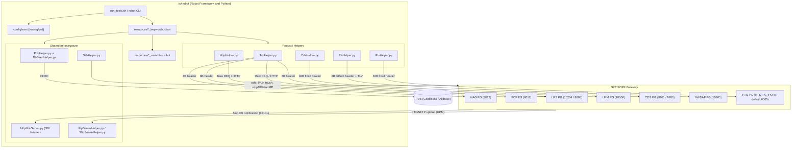

# ARCHITECTURE — System and Module Structure

Architecture of **tc4robot**, a Robot Framework-based regression automation testing tool for PG (PCRF Gateway).
Detailed specifications live in topic and node documents; this document maps responsibilities to files.

## 1. System Overview

The suite validates PG interfaces for seven external nodes: NAG, PCF, LRS, UPM,
CDS, NWDAF, and RTS. The tool actively connects to each node's PG listener, sends
and receives messages, and checks responses and state changes. Auxiliary receivers
accept PG connections for location queries, SBI notifications, and file transfers.



See [INTERFACES.md](INTERFACES.md) for connection direction, ports, headers, and bodies.

## 2. Four-Layer Architecture

```text
Test suites: tests/*/*.robot
    Scenarios, TC names, tags, suite/test setup and teardown
        ↓
Business keywords: resources/*_keywords.robot
    Domain operations, send/receive sequences, and response assertions
        ↓
Variables and configuration: config/env/*, resources/*_variables.robot
    Environment overrides and shared PG_HOST inheritance
        ↓
Protocol and transport helpers: libraries/*.py
    Socket management, binary packing, TLV encoding, and infrastructure services
```

### Test Suite Layer

Node suites such as [NAG](../tests/nag/nag_tests.robot) and
[PCF](../tests/pcf/pcf_tests.robot) define scenarios. Suite setup and teardown own
connections; `Check <IFACE> Socket` in test setup checks their state.
See [TC conventions](../tests/TC_CONVENTION.md) for authoring rules.

### Business Keyword Layer

`resources/*_keywords.robot` implements node operations, message construction,
and response header/body parsing and assertions.

### Variable and Configuration Layer

- [Shared variables](../resources/variables.robot) contain constants and shared settings,
  including `${SBI_NOTI_PORT}` and `${PDB_TIMEOUT}`.
- Environment-only values (`${PG_HOST}`, `${TOOL_HOST}`, `${PDB_CONNSTR}`, and
  `${SUBS_MDN_*}`) come from `config/env/<env>.py`, loaded with `--variablefile`.
  They have no shared dev fallback: missing values fail instead of silently targeting dev.
- Node-specific variable files reference shared variables and environment values.

Tracked environment files are [dev.py](../config/env/dev.py) and
[stg.py](../config/env/stg.py). Production configuration is supplied separately.
See [environment rules](ENVIRONMENTS.md) for precedence and shared configuration axes.

### Protocol and Transport Helper Layer

Eleven Python helpers fall into three groups:

- **Six protocol/data helpers:** [TcpHelper](../libraries/TcpHelper.py),
  [TlvHelper](../libraries/TlvHelper.py), [CdsHelper](../libraries/CdsHelper.py),
  [HttpHelper](../libraries/HttpHelper.py), [RtsHelper](../libraries/RtsHelper.py),
  and [PdbHelper](../libraries/PdbHelper.py). PdbHelper checks database application
  rather than constructing wire messages; CDS, RTS, and seed setup share it.
- **Three receivers:** [HttpNotiServer](../libraries/HttpNotiServer.py),
  [FtpServerHelper](../libraries/FtpServerHelper.py), and
  [SftpServerHelper](../libraries/SftpServerHelper.py). PG initiates these connections.
- **Two infrastructure helpers:** [DbSeedHelper](../libraries/DbSeedHelper.py)
  and [SshHelper](../libraries/SshHelper.py).

Shared PDB, SBI, and SSH procedures live under [shared/](shared/).
See [Resource instructions and catalog](../resources/AGENTS.md) for responsibilities and functions.

## 3. Key Mechanisms

| Mechanism | Rule | Reference |
|---|---|---|
| Socket lifecycle | Open once per suite and share through Suite Variables; fatal closure checks abort the suite | [Resources](../resources/AGENTS.md), [interfaces](INTERFACES.md) |
| Transaction IDs | `Next TXN ID` never returns zero; wraps from 65535 to 1 | [Resources](../resources/AGENTS.md) |
| Four header families | Shared 8B, CDS 48B, NWDAF 8B plus TLV, RTS 32B; use the matching helper | [Interfaces](INTERFACES.md) |
| Variable precedence | `--variable` > `--variablefile` > suite variables > imported resource variables | [Environments](ENVIRONMENTS.md) |

## 4. Related Documentation

- [Documentation index](README.md)
- [Interface matrix](INTERFACES.md)
- [Environment configuration](ENVIRONMENTS.md)
- [TC authoring conventions](../tests/TC_CONVENTION.md)
- [Resource catalog](../resources/AGENTS.md)
- [Node specifications](../tests/AGENTS.md)
- Shared [PDB](shared/PDB.md), [SBI notifications](shared/SBI_NOTI.md), and [SSH](shared/SSH.md)
- [Agent instructions](../AGENTS.md)

Call-flow documents are developer-only reference material, not required TC authoring guidance.
