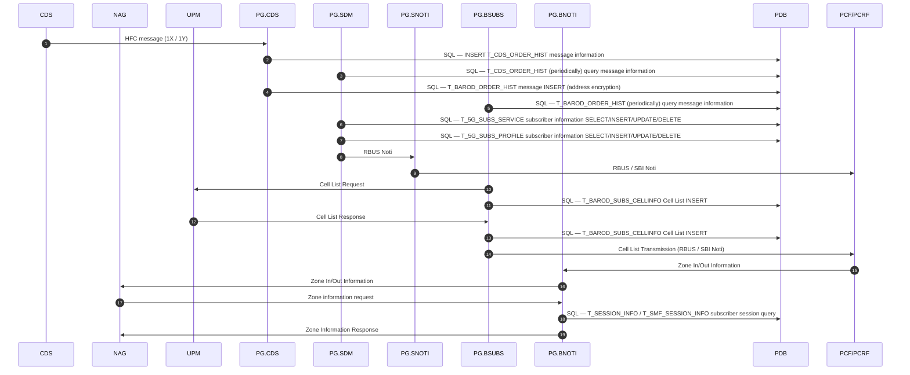

# INTERFACES — Inter-node interconnection matrix

A table that collects the direction, port, and message format of the 7 PG interconnected nodes on one page. No matter which node you touch, you can see it from here.
For details, refer to each node specification (`tests/<iface>/AGENTS.md`).

## At a glance

| node | tool role | Connection direction | port | header | Body | socket |
|---|---|---|---|---|---|---|
| [NAG](../tests/nag/AGENTS.md) | NAG | Client → PG | 8012 | 8B `0x00` | JSON | Dual (+8890 Listen) |
| [PCF](../tests/pcf/AGENTS.md) | PCF | Client → PG | 8011 | 8B `0x00` | JSON | Dual (+NAG 8012) |
| [LRS](../tests/lrs/AGENTS.md) | LRS | Client → PG.LRS | 10204 | None/HTTP | raw `REQ`/`ANS`, HTTP AIMS | Dual (+8890 Listen) |
| [UPM](../tests/upm/AGENTS.md) | UPM | Client → PG | 10506 | 8B `0x00` | JSON | single |
| [CDS](../tests/cds/AGENTS.md) | CDS | Client Dual → PG.CDS | Rch 9201 → Sch 9200 | 48B | fixed message | dual |
| [NWDAF](../tests/nwdaf/AGENTS.md) | NWDAF | Client → PG | 10305 | 8B Bitfield | TLV binary | single |
| [RTS](../tests/rts/AGENTS.md) | RTS | Client → PG.RTS | ${RTS_PG_PORT}(6003, setting file link TODO) | 32B | Fixed width (roaming blocking L1/L2) | single |

The tool initiates each node's primary PG connection. NAG and LRS also accept
PG connections on the auxiliary LRS-PCF channel (8890). SBI and FTP/SFTP receivers
are additional listeners described in the applicable shared and node references.

Hosts inherit environment values such as `${PG_HOST}` from `config/env/<env>.py`;
there is no shared dev fallback in `resources/variables.robot`.
`run_tests.sh all <IP>` loads dev configuration and overrides `PG_HOST`.

## 4 series of message formats

| series | header | module | node to write |
|---|---|---|---|
| 8-octet common | Byte0 `0x00`(ProtoVer 0) / `0x20`(LRS series) | `TcpHelper.py` (`WITH NAME Tcp`) | NAG, PCF, UPM, LRS-PCF channels |
| 48-octet CDS | Message ID / TID(date+seq) / System·App ID / Continue / Serial / Data Size | `CdsHelper.py` (`Cds`) | CDS |
| 8-octet NWDAF | Byte0 bitfield (Ext/ProtoVer/HdrType/MsgType) + SvcId(2B) + MsgId(3B) + BodyLen(2B) | `TlvHelper.py` (`Tlv`) | NWDAF |
| 32-octet RTS | Message ID / TID(date+seq) / Source·Dest System ID / Data Size | `RtsHelper.py` (`Rts`) | RTS |

`txn_id` can never be 0 as  (specification specified). The `Next TXN ID` keyword forces it.
NWDAF uses Message Id (0x000~0xFFF cycle) instead of `txn_id`.

## Dual socket architecture — which node opens which channel first

NAG — client 8012 and server 8890. The current suite prepares the side channel first:

```text
1. Listen/accept on LRS-PCF (8890).
2. Receive PG Hello-Request (0x01), reply Hello-Response (0x02).
3. Open NAG (8012); TC-NAG-001 performs NAG Hello.
```

Subs-Cellid sends `0x0b`; PG then requests Location-Info (`0x05`) on the side
channel. The tool must reply `0x06` before receiving the completed `0x0c` response.
Opening NAG last avoids idle disconnection while waiting for the LRS connection.
See the [NAG specification](../tests/nag/AGENTS.md) for prerequisites and current limits.

PCF — NAG 8012 (session pre-registration) + PCF 8011. Both sockets must survive until the end of the suite.

LRS — Client 10204 + Server 8890. Uses the same 8890 channel as NAG.
During Session-Info (HTTP) processing, PG sends `0x05` to 8890, so the same preprocessing is required.

CDS — Connect Rchannel (9201) first and open Schannel (9200) later. Each channel
A handshake is performed by sending a ConnectionRequest and receiving an ACK.

| order | channel | send | expected response |
|---|---|---|---|
| 1 | Rchannel 9201 | `0003` RchannelConnectionRequest | `0004` ACK |
| 2 | Schannel 9200 | `0001` SchannelConnectionRequest | `0002` ACK |

## HFC Service Call Flow — How the three nodes connect

suite tests CDS, UPM, and NAG independently, but is one chain in operation.
When an HFC subscription (`1X`) / cancellation (`1Y`) message is received, UPM's Cell List round trip and NAG's Zone information are sent.
It happens in a chain until the round trip. Here, it is revealed why the suite holds these three nodes together.

Source: `PG (PCF Gateway) Training Materials` Chapter 03 — *02. Operation Flow for each PG service — HFC service*.



`RBUS / SBI Noti` varies depending on the subscriber — RBUS for LTE, SBI for SA.
The session table is also `T_SESSION_INFO`(LTE) / `T_SMF_SESSION_INFO`(SA).
For detailed LTE/SA support, refer to [CDS Node Specification](../tests/cds/AGENTS.md#ltesa-differences--only-table-names-and-noti-method).

☞ Some messages are not NOTIed with PCF/PCRF.

### Which arrow is which TC in the suite?

Only the sections that the tool actually catches are selected. The rest are all inside the PG and are not visible.

| arrow of flow | tool side | opcode/message | basis |
|---|---|---|---|
| `CDS → PG.CDS` HFC message | CDS suite | `0015` CommandRequest, JOB Code `1X`/`1Y` | Confirmed — [CDS Business Code](../tests/cds/AGENTS.md#set-of-fields-by-business-code) |
| `PG.BSUBS → UPM` Cell List Request | UPM suite (manual reception) | `0x07` `${MSG_UPM_SUBS_INFO_REQ}` | Confirmed — [Consistent with PG → UPM direction of UPM message type ](../tests/upm/AGENTS.md#message-type--two-way) |
| `UPM → PG.BSUBS` Cell List Response | UPM suite | `0x08` `${MSG_UPM_SUBS_INFO_RESP}` | Confirmed |
| `PG.BNOTI → NAG` Zone In/Out Information | NAG suite (passive reception) | `0x07` `${MSG_ZION_REQ}` | estimated — It is true that ZION is in the PG → NAG direction, but it is not confirmed whether it is the same as this arrow. |
| `NAG → PG.BNOTI` Zone Information Request/Response | NAG suite | `0x09`/`0x0a` `${MSG_SUBS_ZONE_STATUS_*}` | estimate — Same as above |

`1X` has a set of fields secured in [CDS node specification](../tests/cds/AGENTS.md#set-of-fields-by-business-code), but
`1Y` (HFC cancellation) is unconfirmed . Since this flow deals with `1X`/`1Y` as a pair, getting the 1Y list gives
Be sure to compare.

~~Unconfirmed~~ Subject who reads and writes `T_BAROD_ORDER_HIST` — Confirmed (2026-08-04).
Written by PG.CDS and read periodically by PG.BSUBS. What was previously depicted as read by SDM
It was corrected.

The above diagram is a summary. The actual processing of a 1X message has more elements than the above —
Masking/encryption double storage of address field, Base64 encoding when linking UPM, decryption inquiry of EMS,
Asynchronous processing based on DB polling of BSUBS.

> `callflow/CDS_X1.md`, which drew these four together, was deleted on 2026-08-21.
> All that remains in the document now are the four lines above — if you need the PG internal details again
> You will need to re-open or restore the document from the PG source.

## Opcode conflict — Use the constant name for each node as is.

The same opcode has a different meaning for each node. Do not write numbers directly, but use constant names.

| opcode | NAG | PCF | LRS(8890) | UPM |
|---|---|---|---|---|
| `0x05` | | `${MSG_PCF_ZONE_REQ}` | `${MSG_LOC_INFO_REQ}` | `${MSG_UPM_SUBS_CHANGE_REQ}` |
| `0x06` | | `${MSG_PCF_ZONE_RESP}` | `${MSG_LOC_INFO_RESP}` | `${MSG_UPM_SUBS_CHANGE_RESP}` |
| `0x07` | `${MSG_ZION_REQ}` | | | `${MSG_UPM_SUBS_INFO_REQ}` |
| `0x09` | `${MSG_SUBS_ZONE_STATUS_REQ}` | | | `${MSG_UPM_CELLINFO_NOTI_REQ}` |
| `0x0b` | `${MSG_SUBS_CELLID_REQ}` (ADOT) | | | `${MSG_UPM_SUBS_SYNC_REQ}` |

Only `0x01`~`0x04`(Hello/Ping) is shared in `resources/variables.robot`.

## Connection information by environment

For port and host, use the default value of each `<iface>_variables.robot`, and if it differs depending on the environment,
Override by node in `config/env/<env>.py` — [ENVIRONMENTS.md](ENVIRONMENTS.md).

```bash
bash run_tests.sh cds stg
```

`DynamicVars`, which read PG's `PG_V2.cfg` through SSH in the past, has been removed.
This is because the actual cfg values were all the same as the hard-coded default values, so there was no difference in operation.

## Behavior when connection fails

Common to all nodes. If the `Check ... Socket` series keyword of `Test Setup` is used when the socket is closed,
`Fatal Error` Stop the entire suite immediately. This is because if there is no connection, subsequent TC is meaningless.
Do not add TC-specific connect/disconnect — see detailed rules in [Resource instructions and catalog](../resources/AGENTS.md).

NWDAF only `Nwdaf Peer Closed`(Non-blocking `MSG_PEEK`) to detect FIN/RST on the PG side.
`Is Connected` on other nodes only sees the local fd, so it does not know that the peer has hung up.
