# Call flow by CDS business code

This developer reference describes PG processing and validation evidence for each CDS business code.
**Field sets are extracted directly from `libraries/CdsHelper.py` `_fill_command_fields()`**,
so the implementation, rather than the specification table, defines the generated layout.

> Generated by `gen_callflow.py`. **Do not edit this file directly.**
> Update the generator tables (`T`, `PDB_*`, `SDM_APPLY`, and related data), then regenerate:
> `python docs/callflow/gen_callflow.py` from the repository root.

## PG process list

These PG processes participate in the flow. **Confirm they are running before integration execution.**
A stopped downstream process can leave message exchanges apparently successful (`0017` returns `SC`)
while DB assertions fail. Process names come from `/PG/CFG/ST.cfg`.

| Process | Diagram participant | Responsibility |
|---|---|---|
| `CDS201` | `PG.CDS` | Receive message, load `T_CDS_ORDER_HIST` / `T_BAROD_ORDER_HIST`, reply `0016`·`0017` |
| `P_SDM601` | `PG.SDM` | **Main Processing** (Goldilocks) — History polling → `T_5G_SUBS_*` reflection → RBUS NOTI |
| `R_SDM601` | `PG.SDM` | **Coupon expiration processing** (Goldilocks) — Pick up and reflect expiration cases created by `RDS601` |
| `P_SDM501` | `PG.SDM` | **For Altibase** with the same role as `P_SDM601` — Runs in the `PCRF_SUPPORT=Y` environment |
| `S_SDM501` | `PG.SDM` | SDM process for Altibase — role unknown, needs confirmation with PG source |
| `R_SDM501` | `PG.SDM` | Coupon expiration processing **for Altibase** with the same role as `R_SDM601` — Runs in the `PCRF_SUPPORT=Y` environment |
| `SNOTI501` | `PG.SNOTI` | SBI Noti to PCF after session inquiry |
| `BSUBS201` | `PG.BSUBS` | BAROD (HFC) processing, UPM round trip, CellList load/delete |
| `RDS601` | `PG.RDS` | Poll reservation queue (`T_5G_RESERVED_JOB`) — generate coupon expiration (`K3`) |

The diagram combines SDM into one participant, but two or four processes can be involved.
Business-code application uses `P_SDM601`/`P_SDM501`; only coupon expiration in the K1 section
uses `R_SDM601`/`R_SDM501`. The Altibase `5xx` processes are not running in the current DEV/TB
environments because both have `PCRF_SUPPORT=N`. See the two-HIST-table section of `../../tests/cds/AGENTS.md`.

> Coupon expiration (`K3`) uses `RDS601` followed by `R_SDM601`, unlike other business codes.
> If `TC-CDS-020` fails after its three-minute wait, inspect these two processes.
> If the reservation changes only to `STATUS=E` and there is no expiration message in `T_5G_RESERVED_ORDER_HIST`,
> `R_SDM601` has nothing to consume, so the coupon row remains indefinitely (observed 2026-08-27).

## HIST Rules (2026-08-19)

The HIST table written by PG.CDS determines whether BSUBS processes a business code.
See the two-HIST-table section of `../../tests/cds/AGENTS.md` for write conditions on
`T_CDS_ORDER_HIST` and `T_BAROD_ORDER_HIST`. Apply the following rules from top to bottom.

**Processing and SNOTI notification are separate.** BSUBS processes `1X`/`1Y` and notifies SNOTI directly.
For `C1`/`G1`/`D3`, BSUBS polls `T_BAROD_ORDER_HIST` and performs the UPM round trip
to update CellInfo, but **does not notify SNOTI**. SDM sends its own unconditional notification
through a separate path. See the detailed note below.

| Rule | Business-code condition | HIST path |
|---|---|---|
| 1 | `1X`, `1Y` | Always **CDS → BSUBS** (`T_BAROD_ORDER_HIST`) |
| 2 | HFC already subscribed, and `D3`, `C1`, `G1`, or `Z1` | **CDS → BSUBS** (`T_BAROD_ORDER_HIST`) |
| 3 | All codes | Always **CDS → SDM** (`T_CDS_ORDER_HIST`) |

Rules 1 and 3 depend only on the business code; rule 2 also depends on HFC subscription state.
Without an HFC subscription, no matching BAROD history is written for rule 2, so BSUBS has
nothing to poll and processing follows the SDM path.

The notification paths converge at `PG.SNOTI`; received SBI payloads alone do not identify the origin.
The suite therefore calculates the expected route from these rules and includes it in failures.

> Historical observation before the dedicated HFC chain: rule 2 was not exercised while HFC was subscribed.
> `1Y` (004) cancels HFC before `C1` (007), `G1` (015), `D3` (027), and `Z1` (028),
> That earlier ordering exercised SDM paths. Current cases 024–027 explicitly restore HFC before C1/G1/D3; see the CDS node specification.

> **BSUBS does not notify SNOTI for `C1`/`G1`/`D3` (confirmed 2026-10-16).**
> `processInfoChgReq`/`processInfoChgRes` (`C1`/`G1`) and `processSubsChgReq` (`D3`)
> contain no `sendnotiByRbus` or `sendnotiByHttp` calls. Even for HFC subscribers, BSUBS
> completes only the UPM CellInfo update. The SBI notification is sent **once**, through SDM
> `doNoti()`. The previous 2026-08-28 note claiming that HFC `D3` sends two SBI notifications
> was incorrect. BSUBS directly notifies SNOTI only for rule 1,
> namely unconditional `1X`/`1Y` processing.

> **BSUBS polling and CDS writes may target different DB sets; intent still needs confirmation.**
> With `bSelectAltibase_ == true`, BSUBS `PollingMgr::service` polls only Altibase,
> not Goldilocks. `UpdateCdsHist`, which writes `T_BAROD_ORDER_HIST`, may insert into
> both databases. If read-side selection does not match the write-side configuration,
> updates in the database that BSUBS does not poll can remain unprocessed.
> Check both settings together when changing this configuration.

> | Environment | `PCRF_SUPPORT` | `ALTIBASE_USE` | Impact |
> |---|---|---|---|
> | DEV | `N` | `N` | Goldilocks for both writing and reading — matching, no symptoms |
> | TB | `N` | `Y` | Writes both DBs, reads Goldilocks only; no observed symptom because Goldilocks receives every write |

> Both current environments use `PCRF_SUPPORT=N`; no resulting symptoms have been observed.
> Check `ALTIBASE_USE` as well whenever an environment switches to `PCRF_SUPPORT=Y`.

## How to read diagrams

Orange bands (`★ Assertions`) identify the assertions that determine TC success or failure.
Unshaded message exchanges and internal processing provide context. `0017=SC` does not override a failed assertion.
Before/after checks (`C1`, `G1`, `D3`) have two bands: the pre-send baseline and the post-send aggregate.

## Common rule for judgment — judgment is not made through message round trip

These rules apply to all 11 codes. Each code section adds its specific acceptance criteria.

`0016 CommandRequestACK` acknowledges receipt before processing and cannot prove business success.

What `0017 CommandResult` carries is **the success or failure of loading message history**. If INSERT fails, it is `FA`. If it succeeds, the body content is `SC`, regardless of whether it is business-wise or not.
PG.SDM applies subscriber changes asynchronously, so verify application through PDB assertions.

## Common rules for message body — always 327B

The body is always 327B. Each code fills its own fields and leaves all others space-padded.

The source is the `_fill_command_fields()` branch of `libraries/CdsHelper.py` — **This code, not the specifications, is the standard for the wire.**
Fields not handled by a code branch are silently discarded even when supplied.

## Business code

All 11 listed codes are actually sent by the suite. `K3` is not a CDS input code:
PG.RDS creates it when the reservation queue reaches coupon expiration time.
See the final two steps in [K1](#cds-k1).

| Business code | Description | TC | Route | Notification assertion |
|---|---|---|---|---|
| [`A1`](#cds-a1) | New sign up | `TC-CDS-002` | SDM | Skip ⚠️ |
| [`1X`](#cds-1x) | Sign up for HFC service | `TC-CDS-003` | BSUBS (unconditional) | OK |
| [`1Y`](#cds-1y) | Termination of HFC service | `TC-CDS-004` | BSUBS (unconditional) | OK |
| [`I2`](#cds-i2) | Additional service application | `TC-CDS-005` | SDM | OK |
| [`I3`](#cds-i3) | Cancellation of additional services | `TC-CDS-006` | SDM | OK |
| [`C1`](#cds-c1) | Change device | `TC-CDS-007 / 008~014` | BSUBS/SDM (HFC status) | OK |
| [`G1`](#cds-g1) | Change information | `TC-CDS-015 / 016~017` | BSUBS/SDM (HFC status) | OK |
| [`K1`](#cds-k1) | Sign up for Data(Time) coupon | `TC-CDS-018 / 020` | SDM | OK |
| [`K2`](#cds-k2) | Data(Time) Coupon Cancellation | `TC-CDS-019` | SDM | OK |
| [`D3`](#cds-d3) | Change number | `TC-CDS-021` | BSUBS/SDM (HFC status) | OK |
| [`Z1`](#cds-z1) | Cancel subscription | `TC-CDS-028` | BSUBS/SDM (HFC status) | Skip ⚠️ |

⚠️ = Skip the judgment in `@{CDS_NOTI_EXEMPT_CODES}`. This is a point that violates the above route rules, so confirmation is required (see ⚠️ in the relevant section).

---

## `A1` — New sign up

| Item | value |
|---|---|
| Business Code | `A1` |
| test case | `TC-CDS-002` |
| Notification Path | Via SDM — Rule 3 |
| Notification Judgment | **Skip** — in exception list (⚠️ below) |
| UPM integration | None |
| Loading reservation queue | None |
| Body field count | 18 units / total 327B (fixed) |

> Create a target subscriber for the entire suite to use — if this TC fails, everything falls apart.

### Callflow — `A1`

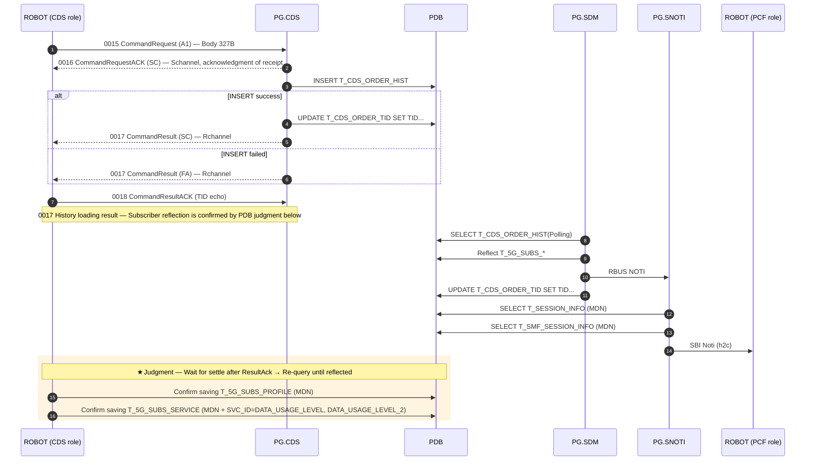

### message Body field — `A1`

Fill in only 18 below and leave the rest blank ([Common Rule](#body-common)).

| # | field | Width (B) |
|---|---|---|
| 1 | `mdn` | 12 |
| 2 | `min` | 10 |
| 3 | `prod_id` | 10 |
| 4 | `data_prod_id` | 10 |
| 5 | `network` | 8 |
| 6 | `tablet_yn` | 1 |
| 7 | `os_ver` | 2 |
| 8 | `device_model` | 4 |
| 9 | `ca` | 1 |
| 10 | `aprf` | 1 |
| 11 | `imsi` | 15 |
| 12 | `mvno` | 1 |
| 13 | `limit` | 1 |
| 14 | `ms_type` | 1 |
| 15 | `category_lte` | 2 |
| 16 | `category_5g` | 2 |
| 17 | `device_type` | 1 |
| 18 | `product_type` | 2 |

### Judgment criteria — `A1`

It is not judged by message round trip (`0016`/`0017`) — [See common rule ](#assertions-common).

- `T_5G_SUBS_PROFILE` (MDN) = **1 case**
- `T_5G_SUBS_SERVICE` (MDN, `DATA_USAGE_LEVEL`) = **1 case**
- `T_5G_SUBS_SERVICE` (MDN, `DATA_USAGE_LEVEL_2`) = **1 case**

#### ⚠️ `A1`'s notification judgment is currently turned off

This code is in `@{CDS_NOTI_EXEMPT_CODES}`(A1 / Z1) `Verify SBI Noti Sent` is **skipped**

However, if the above path rule (2026-08-19) is followed, this code will also be notified — **Two instructions are out of sync.** Exception if the rule replaces the previous one. You can remove this code from the list, the path is determined, but SNOTI is converted to PCF. If you don't want to send it, now is the time.

**Judgment was not turned on until confirmed** — If you turn it on and get it wrong, TC will make a decision without reason. Since it is the one that fails, it is difficult to turn back.

[↑ List of business codes](#code-list)

---

## `1X` — Sign up for HFC service

| Item | value |
|---|---|
| Business Code | `1X` |
| test case | `TC-CDS-003` |
| Notification Path | Via BSUBS (**Unconditionally**) — Rule 1 |
| Notification Judgment | `Verify SBI Noti Sent` confirms arrival |
| UPM integration | Receive `0x07` → Reply `0x08` |
| Loading reservation queue | None |
| Body field count | 5 units / total 327B (fixed) |

> UPM `0x07` reception → `0x08` response is required to complete.

### Callflow — `1X`

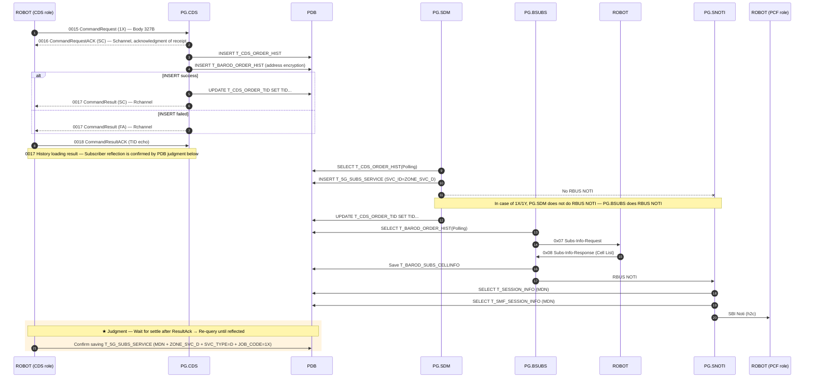

### message Body field — `1X`

Fill in only 5 below and leave the rest blank ([Common Rule](#body-common)).

| # | field | Width (B) |
|---|---|---|
| 1 | `mdn` | 12 |
| 2 | `prod_id` | 10 |
| 3 | `limit` | 1 |
| 4 | `addr` | 170 |
| 5 | `product_type` | 2 |

### Judgment criteria — `1X`

It is not judged by message round trip (`0016`/`0017`) — [See common rule ](#assertions-common).

- `T_5G_SUBS_SERVICE` (MDN, `ZONE_SVC_D`, `SVC_TYPE=D`, `JOB_CODE=1X`) = **1 or more cases**

The notification is viewed by `Verify SBI Noti Sent 1X` (arrival or not). Since the path is not distinguished only by reception, it is calculated by rule and included in the failure message.

[↑ List of business codes](#code-list)

---

## `1Y` — Termination of HFC service

| Item | value |
|---|---|
| Business Code | `1Y` |
| test case | `TC-CDS-004` |
| Notification Path | Via BSUBS (**Unconditionally**) — Rule 1 |
| Notification Judgment | `Verify SBI Noti Sent` confirms arrival |
| UPM integration | Receive `0x07` → Reply `0x08` |
| Loading reservation queue | None |
| Body field count | 4 units / total 327B (fixed) |

> Take UPM like 1X — Even if you cancel, you need to organize cell information.

### Callflow — `1Y`

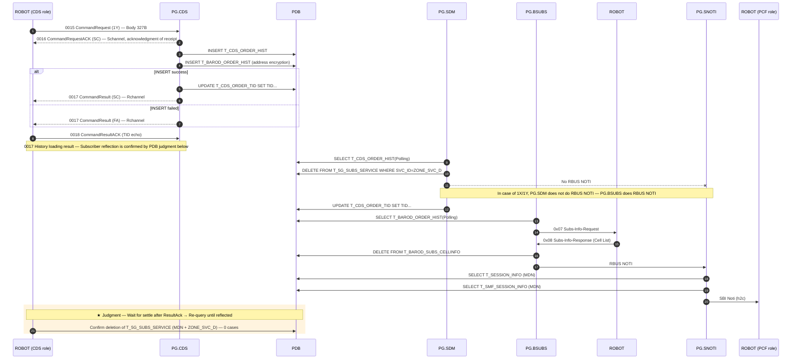

### message Body field — `1Y`

Fill in only 4 below and leave the rest blank ([Common Rule](#body-common)).

| # | field | Width (B) |
|---|---|---|
| 1 | `mdn` | 12 |
| 2 | `prod_id` | 10 |
| 3 | `limit` | 1 |
| 4 | `product_type` | 2 |

### Judgment criteria — `1Y`

It is not judged by message round trip (`0016`/`0017`) — [See common rule ](#assertions-common).

- `T_5G_SUBS_SERVICE` (MDN, `ZONE_SVC_D`) = **0 cases** — `SVC_TYPE`/`JOB_CODE` It does not matter (if it remains in any form, it is less likely to be cancelled)

The notification is viewed by `Verify SBI Noti Sent 1Y` (arrival or not). Since the path is not distinguished only by reception, it is calculated by rule and included in the failure message.

[↑ List of business codes](#code-list)

---

## `I2` — Additional service application

| Item | value |
|---|---|
| Business Code | `I2` |
| test case | `TC-CDS-005` |
| Notification Path | Via SDM — Rule 3 |
| Notification Judgment | `Verify SBI Noti Sent` confirms arrival |
| UPM integration | None |
| Loading reservation queue | None |
| Body field count | 8 units / total 327B (fixed) |

> `LIMIT` is a reserved word, so it is enclosed in double quotation marks in SQL. `TIME_PERIOD_ID` is Removed from WHERE clause (2026-09-29) — It is not a decision condition.

### Callflow — `I2`

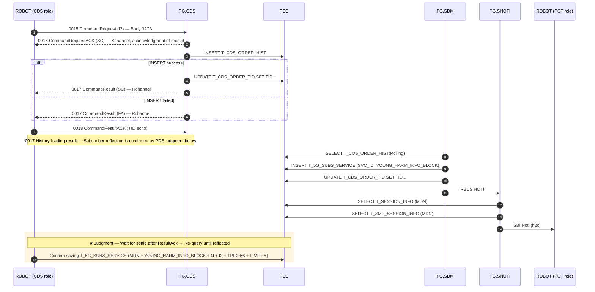

### message Body field — `I2`

Fill in only 8 below and leave the rest blank ([Common Rule](#body-common)).

| # | field | Width (B) |
|---|---|---|
| 1 | `mdn` | 12 |
| 2 | `min` | 10 |
| 3 | `prod_id` | 10 |
| 4 | `block_data_roaming_id` | 1 |
| 5 | `block_data_roaming_provider_id` | 1 |
| 6 | `block_harmful_yn` | 1 |
| 7 | `limit` | 1 |
| 8 | `product_type` | 2 |

### Judgment criteria — `I2`

It is not judged by message round trip (`0016`/`0017`) — [See common rule ](#assertions-common).

- `T_5G_SUBS_SERVICE` (MDN, `YOUNG_HARM_INFO_BLOCK`, `SVC_TYPE=N`, `JOB_CODE=I2`, `"LIMIT"=Y`) = **1 or more cases**

The notification is viewed by `Verify SBI Noti Sent I2` (arrival or not). Since the path is not distinguished only by reception, it is calculated by rule and included in the failure message.

[↑ List of business codes](#code-list)

---

## `I3` — Cancellation of additional services

| Item | value |
|---|---|
| Business Code | `I3` |
| test case | `TC-CDS-006` |
| Notification Path | Via SDM — Rule 3 |
| Notification Judgment | `Verify SBI Noti Sent` confirms arrival |
| UPM integration | None |
| Loading reservation queue | None |
| Body field count | 8 units / total 327B (fixed) |

### Callflow — `I3`

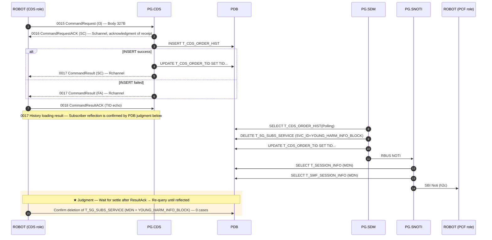

### message Body field — `I3`

Fill in only 8 below and leave the rest blank ([Common Rule](#body-common)).

| # | field | Width (B) |
|---|---|---|
| 1 | `mdn` | 12 |
| 2 | `min` | 10 |
| 3 | `prod_id` | 10 |
| 4 | `block_data_roaming_id` | 1 |
| 5 | `block_data_roaming_provider_id` | 1 |
| 6 | `block_harmful_yn` | 1 |
| 7 | `limit` | 1 |
| 8 | `product_type` | 2 |

### Judgment criteria — `I3`

It is not judged by message round trip (`0016`/`0017`) — [See common rule ](#assertions-common).

- `T_5G_SUBS_SERVICE` (MDN, `YOUNG_HARM_INFO_BLOCK`) = **0 cases**

The notification is viewed by `Verify SBI Noti Sent I3` (arrival or not). Since the path is not distinguished only by reception, it is calculated by rule and included in the failure message.

[↑ List of business codes](#code-list)

---

## `C1` — Change device

| Item | value |
|---|---|
| Business Code | `C1` |
| test case | `TC-CDS-007 / 008~014` |
| Notification Path | HFC **Subscribed** status → BSUBS / **Not subscribed** → SDM — Rule 2 |
| Notification Judgment | `Verify SBI Noti Sent` confirms arrival |
| UPM integration | None |
| Loading reservation queue | None |
| Body field count | 19 units / total 327B (fixed) |

> Because it is a before-and-after comparison type, the `Command Download Flow` **front** baseline is drawn first. The legacy implementation fills in `min ← mdn`.

### Callflow — `C1`

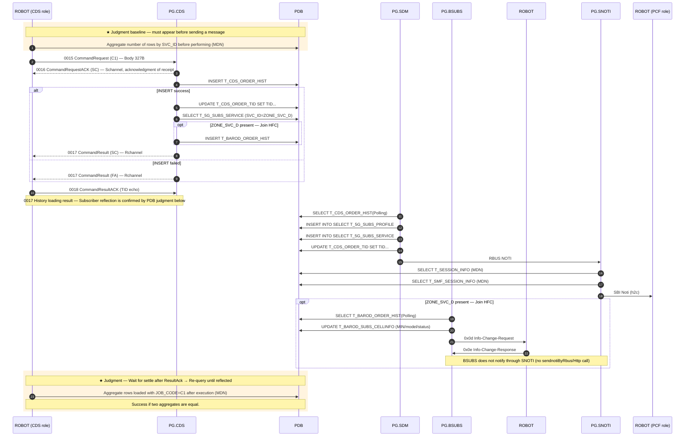

### message Body field — `C1`

Fill in only 19 below and leave the rest blank ([Common Rule](#body-common)).

| # | field | Width (B) |
|---|---|---|
| 1 | `mdn` | 12 |
| 2 | `min` | 10 |
| 3 | `new_min` | 10 |
| 4 | `prod_id` | 10 |
| 5 | `data_prod_id` | 10 |
| 6 | `network` | 8 |
| 7 | `tablet_yn` | 1 |
| 8 | `os_ver` | 2 |
| 9 | `device_model` | 4 |
| 10 | `ca` | 1 |
| 11 | `aprf` | 1 |
| 12 | `imsi` | 15 |
| 13 | `mvno` | 1 |
| 14 | `limit` | 1 |
| 15 | `ms_type` | 1 |
| 16 | `category_lte` | 2 |
| 17 | `category_5g` | 2 |
| 18 | `device_type` | 1 |
| 19 | `product_type` | 2 |

### Judgment criteria — `C1`

It is not judged by message round trip (`0016`/`0017`) — [See common rule ](#assertions-common).

- Number of rows per **Before** `SVC_ID` == Aggregation of rows loaded with **After** `JOB_CODE=C1`

The notification is viewed by `Verify SBI Noti Sent C1` (arrival or not). Since the path is not distinguished only by reception, it is calculated by rule and included in the failure message.

[↑ List of business codes](#code-list)

---

## `G1` — Change information

| Item | value |
|---|---|
| Business Code | `G1` |
| test case | `TC-CDS-015 / 016~017` |
| Notification Path | HFC **Subscribed** status → BSUBS / **Not subscribed** → SDM — Rule 2 |
| Notification Judgment | `Verify SBI Noti Sent` confirms arrival |
| UPM integration | None |
| Loading reservation queue | None |
| Body field count | 18 units / total 327B (fixed) |

> The field set is exactly the same as A1 (confirmed on 2026-08-03).

### Callflow — `G1`

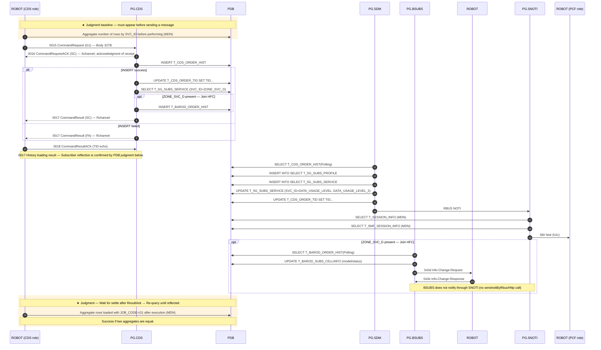

### message Body field — `G1`

Fill in only 18 below and leave the rest blank ([Common Rule](#body-common)).

| # | field | Width (B) |
|---|---|---|
| 1 | `mdn` | 12 |
| 2 | `min` | 10 |
| 3 | `prod_id` | 10 |
| 4 | `data_prod_id` | 10 |
| 5 | `network` | 8 |
| 6 | `tablet_yn` | 1 |
| 7 | `os_ver` | 2 |
| 8 | `device_model` | 4 |
| 9 | `ca` | 1 |
| 10 | `aprf` | 1 |
| 11 | `imsi` | 15 |
| 12 | `mvno` | 1 |
| 13 | `limit` | 1 |
| 14 | `ms_type` | 1 |
| 15 | `category_lte` | 2 |
| 16 | `category_5g` | 2 |
| 17 | `device_type` | 1 |
| 18 | `product_type` | 2 |

### Judgment criteria — `G1`

It is not judged by message round trip (`0016`/`0017`) — [See common rule ](#assertions-common).

- Number of rows per **Before** `SVC_ID` == Aggregation of rows loaded with **After** `JOB_CODE=G1`

The notification is viewed by `Verify SBI Noti Sent G1` (arrival or not). Since the path is not distinguished only by reception, it is calculated by rule and included in the failure message.

[↑ List of business codes](#code-list)

---

## `K1` — Sign up for Data(Time) coupon

| Item | value |
|---|---|
| Business Code | `K1` |
| test case | `TC-CDS-018 / 020` |
| Notification Path | Via SDM — Rule 3 |
| Notification Judgment | `Verify SBI Noti Sent` confirms arrival |
| UPM integration | None |
| Loading reservation queue | Yes |
| Body field count | 6 units / total 327B (fixed) |

> As soon as you sign up, your reservation will expire. **The entry code (K1) and reservation code (K3) are different.** K3 is not a message sent by CDS — **PG.RDS makes the reservation when the coupon expires. Look at the cue and make it yourself.** So K3 does not have a seat. Watching until expiration With `TC-CDS-020`, it does not send a message and waits until RDS clears it. `START_TIME` must be in the future — if it is in the past, it expires immediately after joining and the check fails.

### Callflow — `K1`

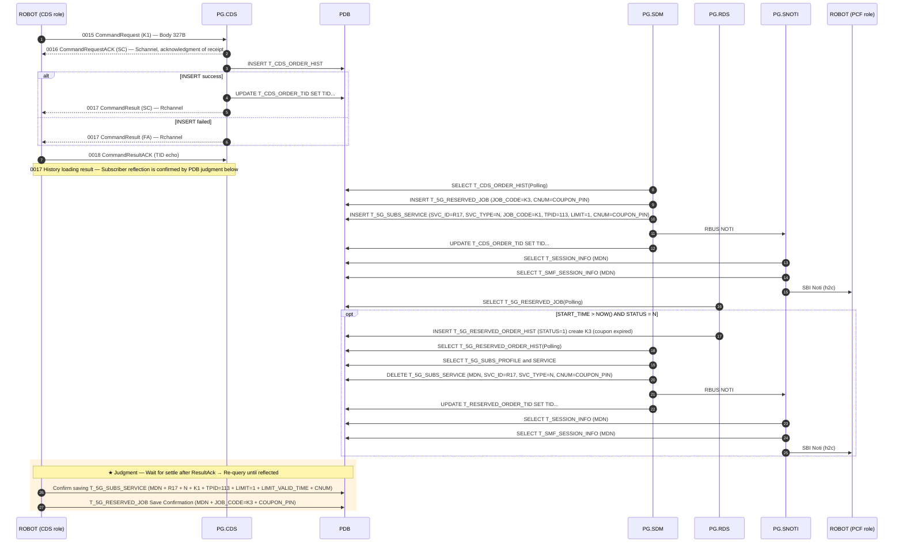

### message Body field — `K1`

Fill in only 6 below and leave the rest blank ([Common Rule](#body-common)).

| # | field | Width (B) |
|---|---|---|
| 1 | `mdn` | 12 |
| 2 | `limit` | 1 |
| 3 | `start_time` | 12 |
| 4 | `coupon_type` | 2 |
| 5 | `coupon_pin` | 11 |
| 6 | `coupon_category` | 1 |

### Judgment criteria — `K1`

It is not judged by message round trip (`0016`/`0017`) — [See common rule ](#assertions-common).

- `T_5G_SUBS_SERVICE` (MDN, `R17`, `SVC_TYPE=N`, `JOB_CODE=K1`, `"LIMIT"=1`, `LIMIT_VALID_TIME`, `CNUM=COUPON_PIN`) = **1 or more cases** (PG also stores `TIME_PERIOD_ID=113`, but removes it from the decision WHERE clause, 2026-09-29)
- `T_5G_RESERVED_JOB` (MDN, `JOB_CODE=K3`, COUPON_PIN) = **1 or more**

The notification is viewed by `Verify SBI Noti Sent K1` (arrival or not). Since the path is not distinguished only by reception, it is calculated by rule and included in the failure message.

[↑ List of business codes](#code-list)

---

## `K2` — Data(Time) Coupon Cancellation

| Item | value |
|---|---|
| Business Code | `K2` |
| test case | `TC-CDS-019` |
| Notification Path | Via SDM — Rule 3 |
| Notification Judgment | `Verify SBI Noti Sent` confirms arrival |
| UPM integration | None |
| Loading reservation queue | None |
| Body field count | 3 units / total 327B (fixed) |

> The criteria for K2/K3/K4/K6 are **literally the same** — they are not distinct from each other, so Divide pins by task.

### Callflow — `K2`

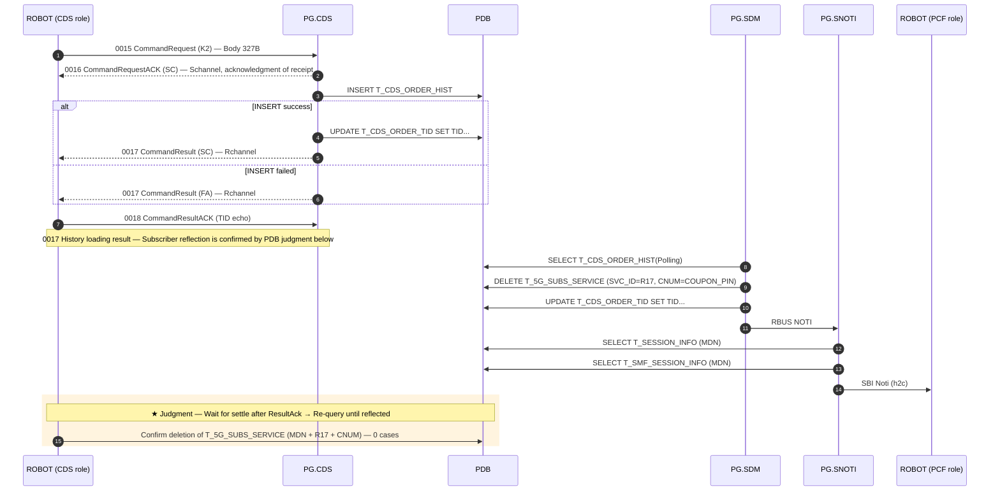

### message Body field — `K2`

Fill in only 3 below and leave the rest blank ([Common Rule](#body-common)).

| # | field | Width (B) |
|---|---|---|
| 1 | `mdn` | 12 |
| 2 | `limit` | 1 |
| 3 | `coupon_pin` | 11 |

### Judgment criteria — `K2`

It is not judged by message round trip (`0016`/`0017`) — [See common rule ](#assertions-common).

- `T_5G_SUBS_SERVICE` (MDN, `R17`, `CNUM=K1_COUPON_PIN`) = **0 cases**

The notification is viewed by `Verify SBI Noti Sent K2` (arrival or not). Since the path is not distinguished only by reception, it is calculated by rule and included in the failure message.

[↑ List of business codes](#code-list)

---

## `D3` — Change number

| Item | value |
|---|---|
| Business Code | `D3` |
| test case | `TC-CDS-021` |
| Notification Path | HFC **Subscribed** status → BSUBS / **Not subscribed** → SDM — Rule 2 |
| Notification Judgment | `Verify SBI Noti Sent` confirms arrival |
| UPM integration | None |
| Loading reservation queue | None |
| Body field count | 19 units / total 327B (fixed) |

> If successful, `${CDS_ACTIVE_MDN}` is updated with a new number → Z1 behind it is canceled with that number.

### Callflow — `D3`

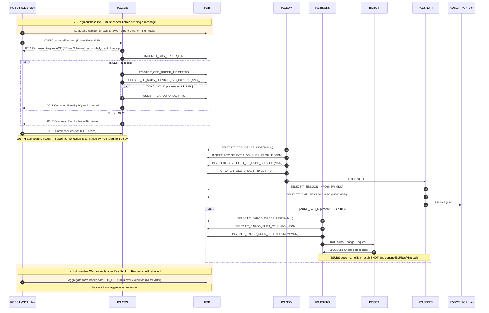

### message Body field — `D3`

Fill in only 19 below and leave the rest blank ([Common Rule](#body-common)).

| # | field | Width (B) |
|---|---|---|
| 1 | `mdn` | 12 |
| 2 | `new_mdn` | 12 |
| 3 | `min` | 10 |
| 4 | `new_min` | 10 |
| 5 | `prod_id` | 10 |
| 6 | `data_prod_id` | 10 |
| 7 | `network` | 8 |
| 8 | `tablet_yn` | 1 |
| 9 | `os_ver` | 2 |
| 10 | `device_model` | 4 |
| 11 | `ca` | 1 |
| 12 | `aprf` | 1 |
| 13 | `imsi` | 15 |
| 14 | `mvno` | 1 |
| 15 | `limit` | 1 |
| 16 | `category_lte` | 2 |
| 17 | `category_5g` | 2 |
| 18 | `device_type` | 1 |
| 19 | `product_type` | 2 |

### Judgment criteria — `D3`

It is not judged by message round trip (`0016`/`0017`) — [See common rule ](#assertions-common).

- Perform **Before** (old number) `SVC_ID` Number of rows per == Perform **After** (new number, `JOB_CODE=D3`) Aggregate

The notification is viewed by `Verify SBI Noti Sent D3` (arrival or not). Since the path is not distinguished only by reception, it is calculated by rule and included in the failure message.

[↑ List of business codes](#code-list)

---

## `Z1` — Cancel subscription

| Item | value |
|---|---|
| Business Code | `Z1` |
| test case | `TC-CDS-028` |
| Notification Path | HFC **Subscribed** status → BSUBS / **Not subscribed** → SDM — Rule 2 |
| Notification Judgment | **Skip** — in exception list (⚠️ below) |
| UPM integration | None |
| Loading reservation queue | None |
| Body field count | 16 units / total 327B (fixed) |

> end of the chain. **You can pass even if you have never signed up** — 0 cases are “deleted” and “never existed before” Can't tell the difference. If HFC (`ZONE_SVC_D`) is attached, **Cell arrangement is included** — The subscriber table is organized only after BSUBS deletes the CellList.

### Callflow — `Z1`

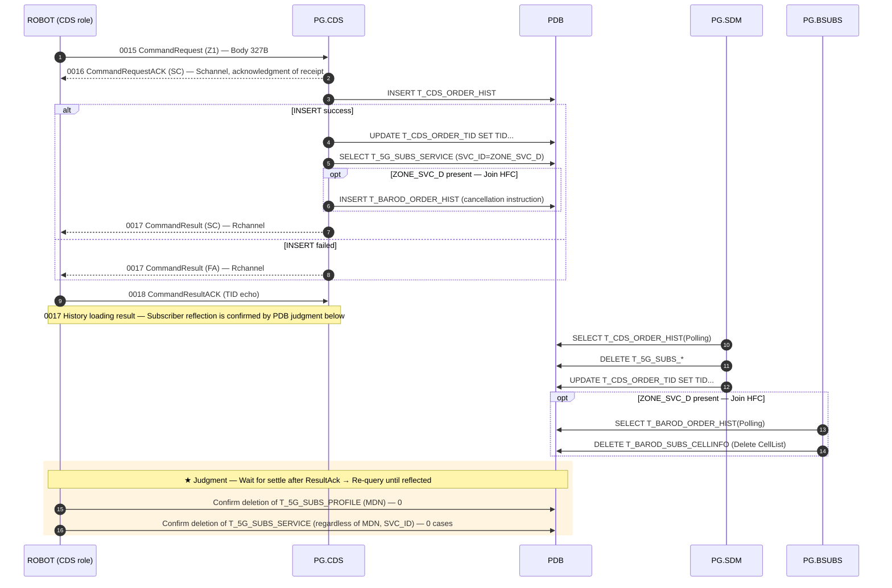

### message Body field — `Z1`

Fill in only 16 below and leave the rest blank ([Common Rule](#body-common)).

| # | field | Width (B) |
|---|---|---|
| 1 | `mdn` | 12 |
| 2 | `prod_id` | 10 |
| 3 | `network` | 8 |
| 4 | `tablet_yn` | 1 |
| 5 | `os_ver` | 2 |
| 6 | `device_model` | 4 |
| 7 | `ca` | 1 |
| 8 | `aprf` | 1 |
| 9 | `imsi` | 15 |
| 10 | `mvno` | 1 |
| 11 | `limit` | 1 |
| 12 | `ms_type` | 1 |
| 13 | `category_lte` | 2 |
| 14 | `category_5g` | 2 |
| 15 | `device_type` | 1 |
| 16 | `product_type` | 2 |

### Judgment criteria — `Z1`

It is not judged by message round trip (`0016`/`0017`) — [See common rule ](#assertions-common).

- `T_5G_SUBS_PROFILE` (MDN) = **0 cases**
- `T_5G_SUBS_SERVICE` (regardless of MDN, `SVC_ID`) = **0 cases**

#### ⚠️ `Z1`'s notification judgment is currently turned off

This code is in `@{CDS_NOTI_EXEMPT_CODES}`(A1 / Z1) `Verify SBI Noti Sent` is **skipped**

However, if the above path rule (2026-08-19) is followed, this code will also be notified — **Two instructions are out of sync.** Exception if the rule replaces the previous one. You can remove this code from the list, the path is determined, but SNOTI is converted to PCF. If you don't want to send it, now is the time.

**Judgment was not turned on until confirmed** — If you turn it on and get it wrong, TC will make a decision without reason. Since it is the one that fails, it is difficult to turn back.

[↑ List of business codes](#code-list)

---

## Other documents

- [../../tests/cds/AGENTS.md](../../tests/cds/AGENTS.md) — CDS node specifications (encoding table, pitfalls, LTE/SA differences)
- `tests/cds/cds_tests.robot` — TCs in the table above
- `libraries/CdsHelper.py` — `_fill_command_fields()` (source of field set)
