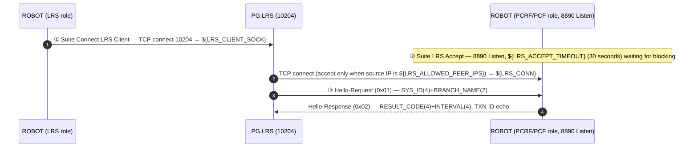
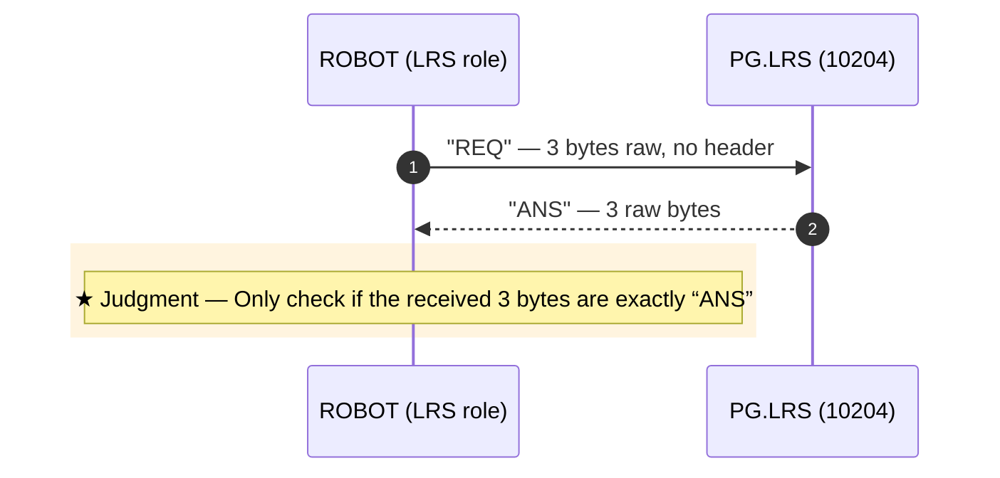
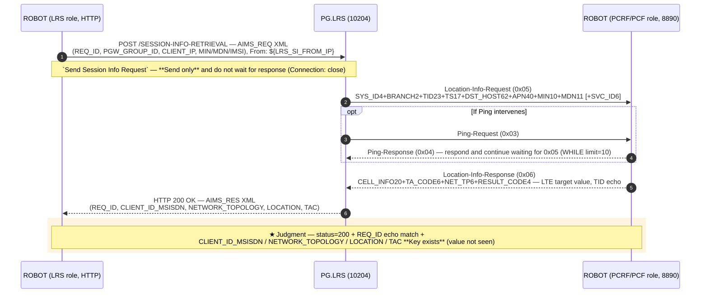

# LRS — Session Information Retrieval (PG.LRS)

| item | value |
|---|---|
| main channel | LRS (Client) → PG.LRS:`${LRS_CLIENT_DEFAULT_PORT}`(10204) — raw TCP `REQ`/`ANS` + HTTP/1.1 XML |
| side channel | PCRF/PCF (Server) — Tool `${LRS_SERVER_PORT}`(8890) Listen, PG.LRS connects |
| side channel protocol | 8-octet header + fixed-length ASCII Body — All sent first by PG (0x01/0x03/0x05) |
| Judgment | PDB None — HTTP status + `AIMS_RES` field exists + `REQ_ID` echo is all |
| TC | `TC-LRS-001`(Health Check) / `TC-LRS-002`(Session-Info). 6 negatives are comments |

> ⚠ There are two protocols on the same port (10204):  — raw 3 bytes without headers (`REQ`/`ANS`)
> HTTP/1.1 is mixed on one port. And the side channel (8890) is the same as the one used by the NAG suite.
> Channel  — Session-Info's side channel round trip is exactly the same pattern as `TC-NAG-007`
> ([nag_callflow.md](nag_callflow.md#callflow-③--subs-cellid-adot-tc-nag-007--the-core-of-this-node)).

## PG process list

Check startup before running the suite. The name is based on `/PG/CFG/ST.cfg`.

| process | Participants in the diagram | What you do |
|---|---|---|
| `G_LRS201` | `PG.LRS` | 10204 (raw `REQ`/`ANS` + HTTP) received, reverse connection to 8890 side channel |
| `CDS201` | `PG.CDS` | Pre-startup required — Load subscriber data viewed by Session-Info (same reason as NAG, user confirmation) |

Two channels are connected to one `G_LRS201`. So if that doesn't work, Suite Setup
8890 After 30 seconds of waiting, there are no other symptoms other than the suite freezing — a failure message appears.
It's easy to get lost in the tools section (`Suite LRS Accept` timeout).

In `ST.cfg`, `A_LRS201` (40060) is paired with `G_LRS201` (40061). `A_` is in this trend
It is not confirmed whether they are involved, so it is not included in the table above.

## Suite Setup — Dual Socket

If the PG is not attached to 8890 within 30 seconds, the setup will fail and the entire suite will stop. — Health Check only
The same applies if you want to turn it around. The operator must prepare the PG connection within that window.

> ★ If it does not attach, start with [`G_LRS201` and start with ](#pg-process-list).

> Side-channel header Byte0 is `0x00`, not `0x20` in standard LRS — PG replaces 0x05
> I checked in the log that Byte0=0x00 was being sent and set the tool to `${LRS_TX_BYTE0}=0`.
> (Same as NAG suite, NAG-Barod series).

## Call Flow ① — Health Check (`TC-LRS-001`)

The default cycle is 30 seconds (read from `${LRS_HC_DEFAULT_INTERVAL}`, `PG_V2.cfg`, default value if not received).
`Send LRS Ping` is the same as REQ → ANS once — it is only used for keepalive of a persistent socket and has no separate opcode.

## Callflow ② — Session-Info (`TC-LRS-002`) ★ The core of this node

The two channels intersect . Since there are no threads, HTTP sending and receiving are separated, and
Insert the side channel round trip (`Handle LRS Location Info`).

When 0x06 goes out, PG fills in LOCATION/TAC and gives 200 — If the side channel is dead, this TC
Failed due to HTTP timeout.

### ⚠ Judgment limits — position values come from the target value given by the tool

The loading position in `0x06` is the LTE target value  of the tool (`${LRS_MOCK_CELL_INFO_LTE}`=`1048575:63`,
`${LRS_MOCK_TA_CODE_LTE}`=`3113`, `${LRS_MOCK_NET_TP_LTE}`=`L`). PG processes it
Since it only returns to `AIMS_RES`, what this TC sees is the relay/assembly accuracy of PG —
The actual network location inquiry is not verified. In addition, the suite only checks the existence of LOCATION/TAC.
Since no value comparison is made, it passes even if a value is different from the target value.

### HTTP Error Codes — All Comments TC

404 (no session) / 403 (`From` IP not registered — `${LRS_SI_FROM_IP}` must be an IP registered in PG) /
400 / 500 / 601(RAA Error) / 602(RAA Timeout). In fact, PG must cause the condition or
All 6 TC items are commented out (`TC-LRS-SI-002`~`007`).

## Judgment criteria

There is no PDB lookup. All you can see is the response.

| hierarchy | Check for | stuck TC |
|---|---|---|
| protocol | raw response = `"ANS"` | 001 |
| protocol | HTTP status = 200 | 002 |
| work | `REQ_ID` echo match | 002 |
| work | `CLIENT_ID_MSISDN` / `NETWORK_TOPOLOGY` / `LOCATION` / `TAC` keys exist | 002 |
| side channel | 0x05 reception itself + TXN ID echo reply — otherwise 002 will time out | 002 |

## trap

- PG side [`G_LRS201`](#pg-process-list) must be running. — Symptoms when stopped
  It appears to be a timeout on the tool side.
- `Check LRS Client Socket` (Test Setup) only sees 10204 — the side channel (`${LRS_CONN}`)
  Even if it is disconnected, `TC-LRS-002` waits for 0x05 and does not know until it times out (same structure as NAG).
- Documentation of the `Suite LRS Accept` keyword says "Hello processing is performed in TC-LRS-001."
  Although it is written as old — in reality, the third step of Suite Setup (`Handle LRS Hello`) is
  Process, TC-LRS-001 is Health Check.
- `lrs_variables.robot` Many variables are appended with `# TODO: real environment` — for operational PG targets
  Replacing the actual environment value comes first ([../../tests/lrs/AGENTS.md](../../tests/lrs/AGENTS.md#open-questions)).
- `0x05` has an opcode overlap with PCF ZONE / UPM Subs-Change — use `${MSG_LOC_INFO_REQ}`.

## Related documents

- [LRS Node Specification](../../tests/lrs/AGENTS.md) — Channel Structure, Message Type, HTTP Response Code
- [nag_callflow.md](nag_callflow.md) — NAG Subs-Cellid flow using the same 8890 side channel
- `tests/lrs/lrs_tests.robot` — `TC-LRS-001`~`002` (active) / SI-002~007 (commentary)
- `resources/lrs_client_keywords.robot` (page 10204) · `resources/lrs_keywords.robot` (page 8890)
