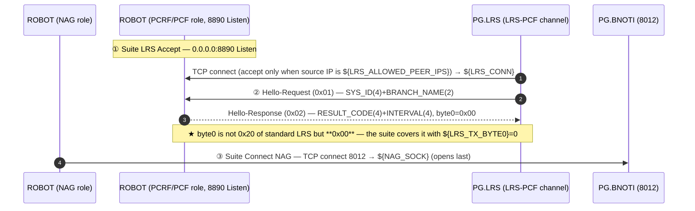
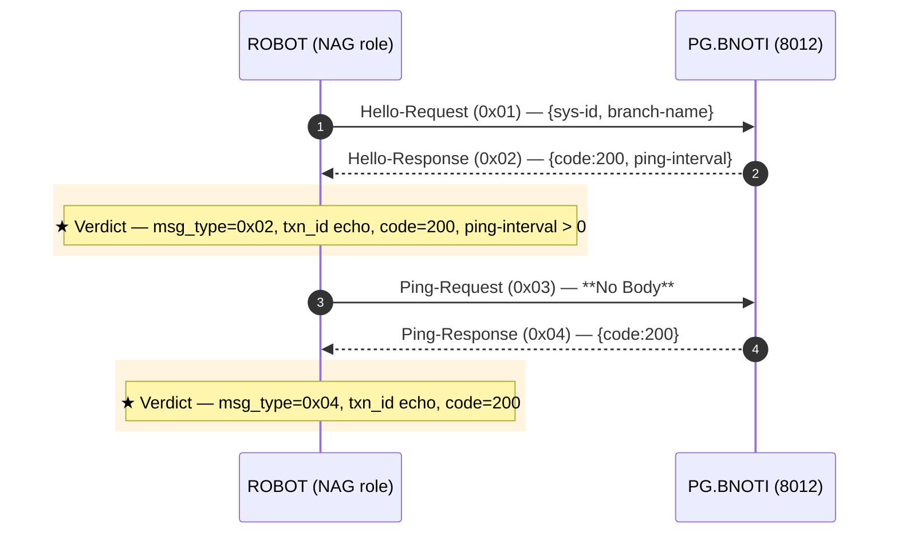
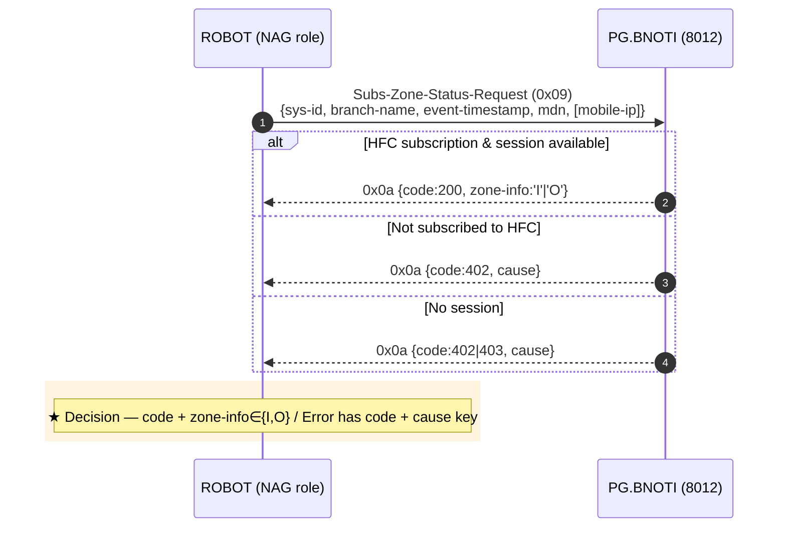
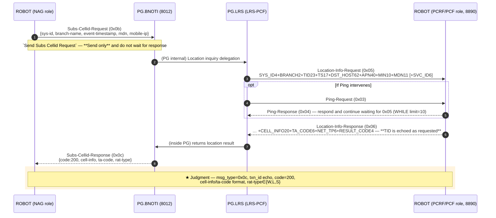
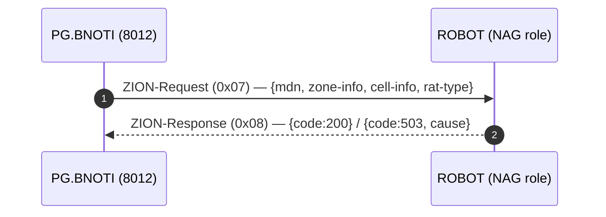

# NAG — HFC/ADOT zone/cell inquiry (PG-SC)

| item | value |
|---|---|
| tool role | NAG (Client) → PG.BNOTI:`${NAG_PG_PORT}`(8012) — Main channel |
| side channel | PCRF/PCF (Server) — Tool `${LRS_SERVER_PORT}`(8890) Listen, PG.LRS connects |
| header | 8B common (`byte0` `msg_type` `body_length`(2, htons) `txn_id`(4, htonl)) |
| Body | Main channel = JSON / Side channel = Fixed length ASCII |
| flagship message | `0x09` Subs-Zone-Status · `0x0b` Subs-Cellid(ADOT) |
| Judgment | PDB None — Response `code` + `txn_id` echo + JSON field format is all |
| TC | `TC-NAG-001`~`007` (7 cases). `0x07/0x08` ZION is commented out |

> ⚠ This node has two sockets. `0x0b` Subs-Cellid doesn't end with just the primary channel round trip —
> PG asks `0x05` back through a side channel, and only when the tool answers `0x06` does `0x0c` come.
> So, Suite Setup is completed with two sockets + side channel hello.

## PG process list

All three must be running to open the suite (user confirmation). Each of the two sockets is held by a different process.
`PG.CDS`, which creates a subscriber, must be running before it.

| process | Participants in the diagram | in charge | startup flag |
|---|---|---|---|
| `G_BNOTI201` | `PG.BNOTI` | Main Channel 8012 — Hello/Ping, `0x09` Subs-Zone-Status, `0x0b` Subs-Cellid, `0x07` ZION Outgoing | `/PG/BIN/PDB_RUN/G_BNOTI201.RUN` |
| `G_LRS201` | `PG.LRS` |  side channel 8890 — Connect back to the tool and ask for `0x05` Location-Info | `/PG/BIN/PDB_RUN/G_LRS201.RUN` |
| `CDS201` | `PG.CDS` | Pre-start required — Receive message and load subscribers | `/PG/BIN/PDB_RUN/CDS201.RUN` |

`/PG/BIN/PDB_RUN/<process>.RUN` is 0 byte flag file — not the content
Presence and absence have meaning (`RDS601.RUN` `G_ZONE201.RUN`, etc. are in the same directory in the same form).

### Determine which one is dead by symptoms

Since this suite goes through both Suite Setup processes, , even if only one TC dies, there is no
It doesn't turn. Since the point of failure is different, it is determined by that.

| symptoms | doubt |
|---|---|
| `Suite LRS Accept` fills 30 seconds and the suite is released. | `G_LRS201` — Does not come attached to 8890 |
| The socket is attached, but `TC-NAG-001` Hello is `9999 Inactive Status` | `G_BNOTI201` — Even if it is running, the response is the same as in Standby. |
| Timeout while waiting for `TC-NAG-007` only side channel `0x05` | `G_LRS201` — If setup has passed but is disconnected in the middle |

2026-08-27 Execution corresponded to the first line — 8890 After completing 30 seconds of waiting, all 7 cases were Suite Setup
failed. The same PG's `0x01` Hello was also `9999 Inactive Status`.

## Suite Setup — Dual Socket

NAG Hello (0x01) is not sent by Suite Setup. — `TC-NAG-001` sends it directly. This is different from other suites.
Only the side channel Hello is processed in Setup (the PG sends it first, so if it is not received, subsequent steps are blocked).

★ The reason why the  order is ①②→③ (2026-10-07) — If you do `Suite Connect NAG` first, the following
`${NAG_SOCK}` while `Suite LRS Accept`/`Handle LRS Hello` (reconnection on PG.LRS side — can be slow)
(8012) does not send anything and remains idle for that much longer. `run_tests.sh all` by
When the NAG runs right after the LRS suite, this idle section becomes longer and PG.BNOTI starts the Hello of `TC-NAG-001`.
There was a case where the connection was disconnected with `Connection reset by peer` at the time of transmission (in NAG standalone execution)
not reproduced). Finish ①② first, which is slow and PG.LRS dependent, and then TC writes `${NAG_SOCK}` immediately.
Minimized the idle section by opening it just before (the very last time) — root cause (idle timeout of PG.BNOTI)
(policy itself) is presumed before the PG source is confirmed.

## Call Flow ① — Hello / Ping (`TC-NAG-001` `002`)

`ping-interval` only accepts the value and does not ping during the  cycle.  — The premise is that the session is not disconnected because the suite is short.

## Callflow ② — Subs-Zone-Status (`TC-NAG-003`~`006`)

`mobile-ip` is Optional — just send it without `TC-NAG-004` and see if it succeeds.
MDN uses dedicated variables for each case: `${NAG_MDN_NORMAL}` / `${NAG_MDN_NO_HFC}` (unsubscribed) / `${NAG_MDN_NO_SESSION}` (no session).

> `TC-NAG-006` passes 402  or  403. According to the standard, 403 (no session) is correct, but the actual PG is
> There are cases where 402 is given, so both are received —  needs to be checked to determine which one is correct..

## Callflow ③ — Subs-Cellid ADOT (`TC-NAG-007`) ★ The core of this node

The two sockets intersect . Since there are no threads in the repo, sending and receiving are separated,
It is processed by inserting a side channel round trip in between.

There are two body widths: 169B (without SERVICE_ID) / 175B (with) — Divide by reception length and unpack
(5G sessions via SBI do not carry SERVICE_ID).

### ⚠ Judgment limits — the value returned is the value given by the tool

The `cell-info`/`ta-code`/`rat-type` sent to `0x06` is the target value of the  tool, .
(`${LRS_MOCK_CELL_INFO_LTE}`=`1048575:63`, `${LRS_MOCK_TA_CODE_LTE}`=`3113`, `${LRS_MOCK_NET_TP_LTE}`=`L`).
PG only returns it as `0x0c`, so field verification of `TC-NAG-007` only sees the relay accuracy of PG as  —
It does not verify whether the cell was properly found in the actual network. If the price is different from the target price, it is actually an abnormal signal.

## Call flow ④ — ZION (PG → NAG, currently inactive)

`TC-NAG-014`~`016` are commented out as  — This is a TC that only works when an actual ZION event occurs on the PG side.
If you put it on autorun, the suite stops listening. To revive it, you first need a means to trigger the event.

## Judgment criteria

There is no PDB lookup. All you can see is the response message.

| hierarchy | Check for | stuck TC |
|---|---|---|
| protocol | `msg_type` (0x02/0x04/0x0a/0x0c) | 001 · 002 · 003 · 007 |
| protocol | `txn_id` Echo | 001 · 002 · 003 · 007 |
| work | `code` = 200 / 402 / 402·403 | former TC |
| work | `zone-info`∈{I,O} · `cell-info` · `ta-code` · `rat-type`∈{W,L,S} | 003 · 007 |
| error | `cause` key exists (value is not seen) | 005 · 006 |

`TC-NAG-004`/`005`/`006` do not check the `txn_id` echo — only look at the response body.

## trap

- Does not detect side channel closure. `Check NAG Socket` (Test Setup) only sees `${NAG_SOCK}`.
  Even if `${LRS_CONN}` is disconnected, you will not know until `TC-NAG-007` actually waits for `0x05` and times out.
- `Tcp.Is Connected` only looks at the local fd. Even if PG is cut off, it passes.
- For `Suite LRS Accept`, if PG is not attached within `${LRS_ACCEPT_TIMEOUT}` (30 seconds), setup will fail.
  The entire suite stands up. — Same goes for when Subs-Cellid is not running.
- `0x07`·`0x09`·`0x0b` have different meanings in different nodes. Instead of writing the numbers directly, use `${MSG_*}`
  ([opcode conflict table](../INTERFACES.md#opcode-conflict--use-the-constant-name-for-each-node-as-is)).

## Related documents

- [NAG Node Specification](../../tests/nag/AGENTS.md) — Connection·Message Type·Response Code
- [LRS Node Specification](../../tests/lrs/AGENTS.md) — Specification for the client mode side of the side channel (LRS-PCF)
- `tests/nag/nag_tests.robot` — `TC-NAG-001`~`007`
- `resources/nag_keywords.robot` · `resources/lrs_keywords.robot` — Main channel/side channel implementation
