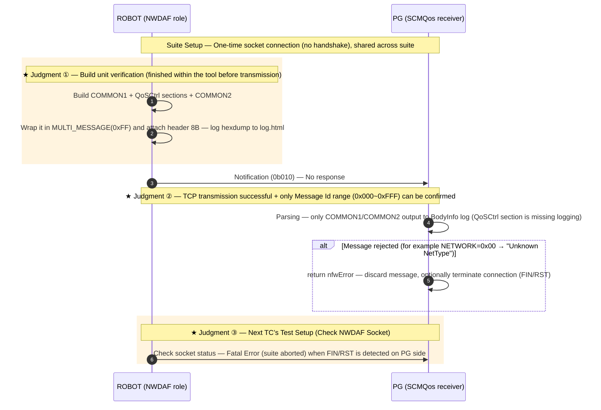
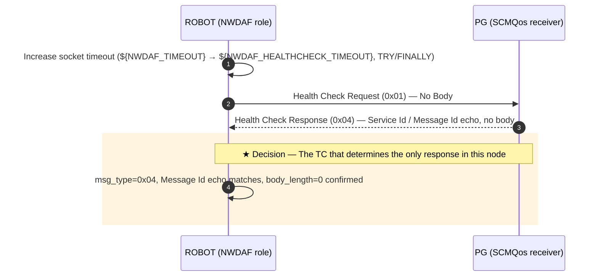
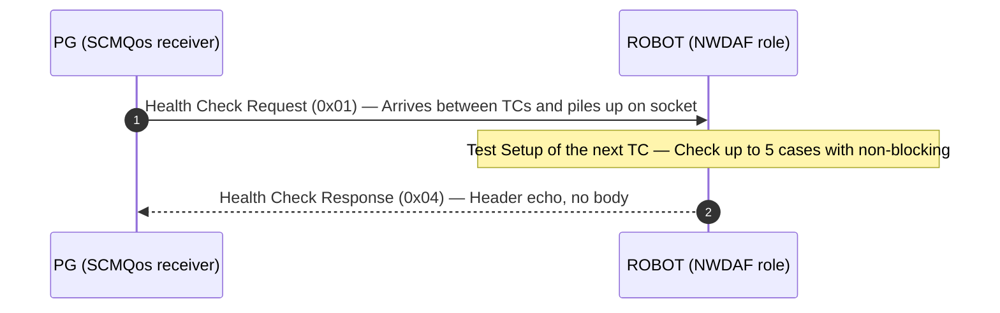

# NWDAF — Base Station Congestion Control (PG.NWMQOS)

| item | value |
|---|---|
| tool role | NWDAF (Client) → PG:`${NWDAF_PORT}`(10305), single socket |
| flagship message | Notification(0b010) — PG no response (standard) |
| secondary message | Health Check Request(0x01) ↔ Response(0x04) — `TC-NWDAF-001` |
| Body | TLV binary — `MULTI_MESSAGE(0xFF){ COMMON1 + QoSCtrl sections + COMMON2 }` |
| Service Id | Only one `0x0305` (QoS control per subscriber) |
| Message Id | `txn_id` role — `Next NWDAF Msg Id` cycles from 0x000 to 0xFFF |
| Judgment | PDB None · No response — Build verification + Transmission success + FIN/RST detection is all (“Judgment blank” below) |

> ⚠ Unlike other nodes, there is no return signal to use for  decision.  Notification does not have a response according to the standard.
> There is none, and there is no interface to view PDB reflection. In fact, 7 out of 8 fields in the eNB section are incorrect.
> There is a precedent where all TCs passed in this state ([../../tests/nwdaf/AGENTS.md](../../tests/nwdaf/AGENTS.md#decision-gap--the-core-constraint-of-this-node)).

## Callflow — Notification (main)

Note that decision ③ takes one TC late — if the PG rejects the message and hangs up, the TC
After already PASSing with “transmission successful”, the next TC’s Test Setup stops the suite.

## Body section combination — PCEF_TYPE bitmask

`PCEF_TYPE` (0x0D) is not an exclusive enum, but a  bitmask. In one message depending on the bit combination
The actual QoSCtrl section is different.

| PCEF_TYPE | Body composition | Representative TC |
|---|---|---|
| `0x01` (P-GW/SMF) | COMMON1 + pcefQoSCtrl + COMMON2 | 002/004, 006~013 |
| `0x10` (eNB) | COMMON1 + enodebQoSCtl + COMMON2 | 003/005, 014~020 |
| `0x03` (LTE DPI) | COMMON1 + pcefQoSCtrl + dpiQoSCtrl + COMMON2 — together in one message | 032 |
| `0x02` (DPI only) | COMMON1 + dpiQoSCtrl + COMMON2 | 033 |
| datalength overlength (negative) | QOS_POLICY(PGW/DPI) / CATEGORY(DPI) / QCI(ENB) larger than the PG buffer, sent over an isolated connection | 034~037 |

## Call Flow — Health Check (`TC-NWDAF-001`)

The Service ID dedicated to Health Check is unknown, so use `0x0305` as is.
([../../tests/nwdaf/AGENTS.md](../../tests/nwdaf/AGENTS.md#-confirmation-required) number 6).

## Reverse Defense — PG-Initiated Health Check

PG periodically sends a Health Check first. Because if the tool doesn't read the socket, it just keeps piling up.
Every TC's Test Setup (`Check NWDAF Socket`) is emptied to `Drain NWDAF Pending Messages`.

## Decision gap — the core constraint of this node

Since there is no response to Notification and no PDB judgment, what the Robot can automatically see is
There are only three.

- message Assembly result — build unit TC (directly verify TLV with `Tlv Find`/`Tlv Find All`, etc.)
- TCP Transmission successful — This says nothing more than that the write was completed without a socket error.
- FIN/RST detection of `Check NWDAF Socket` — When PG rejects the previous message and hangs up, it is caught in the next TC

datalength Overlength negative TC (034~037) is actually transmitted (the length field and number of bytes are always
match), use `Send NWDAF Notification On New Connection` — However, the NWDAF interface of PG is
"Socket: Single" means not opening two shared sockets at the same time: existing `${NWDAF_SOCK}` first
Close it, open exactly one connection in its place, send a message and observe it, then close that connection and start again.
Connect to restore `${NWDAF_SOCK}` to its normal state — always connect only one by one, so that the PG
Even if the value is rejected and disconnected, the next TC starts normally with a new reconnected socket. accept/reject
It is not determined, but only observes whether the connection is maintained (`peer_closed`) and records it.

Separate bug confirmed by ground truth (TC-NWDAF-034): PG parser (`CSCMQosGateway.cpp`'s
`CNWQosGateway::ParsingPacket`) converts a 1-byte length field to `length = *p` (signed char → short).
read If the declaration length is 0x80(128) or more than , it is sign extended by a negative number and the pointer is rewound.
`multiMessageLength` actually increases and the parsing is completely out of sync, eventually resulting in `Unknown TAG(00) Packet
The entire message is discarded with ignore!` (PG silently ignores it without disconnecting). So datalength
All oversize values of negative TC are kept below 0x80 — see details
[See the "Length field sign extension bug" section of the NWDAF node specification](../../tests/nwdaf/AGENTS.md).

A person must check whether the contents are correct — `Send NWDAF Notification` For each transmission
Leave the entire packet hexdump in `log.html`, so bytes with `Header Info`/`BodyInfo` dump of PG
Compare by unit. However, PG's `BodyInfo` outputs only COMMON1 + COMMON2 —
The fact that the pcefQoSCtrl/eNB/DPI field is not visible in the log is not a parsing failure but a logging omission.

## Related documents

- [NWDAF Node Spec](../../tests/nwdaf/AGENTS.md) — Header bit placement, section-wise encoding table, pitfalls, verification required
- `tests/nwdaf/nwdaf_tests.robot` — `TC-NWDAF-001`~`037`
- `resources/nwdaf_keywords.robot` · `libraries/TlvHelper.py` — build/send/drain implementation
