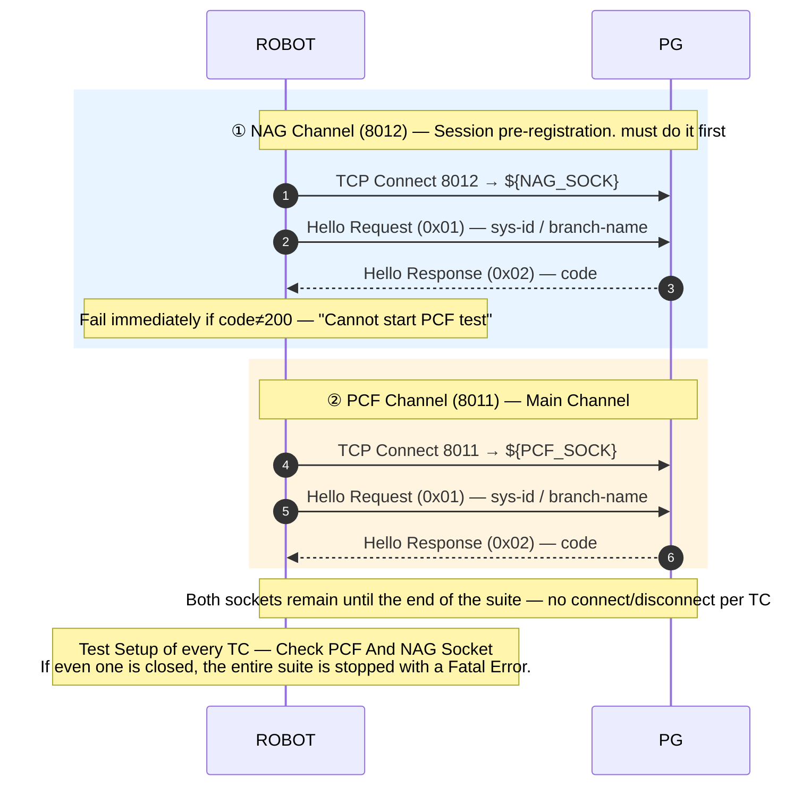
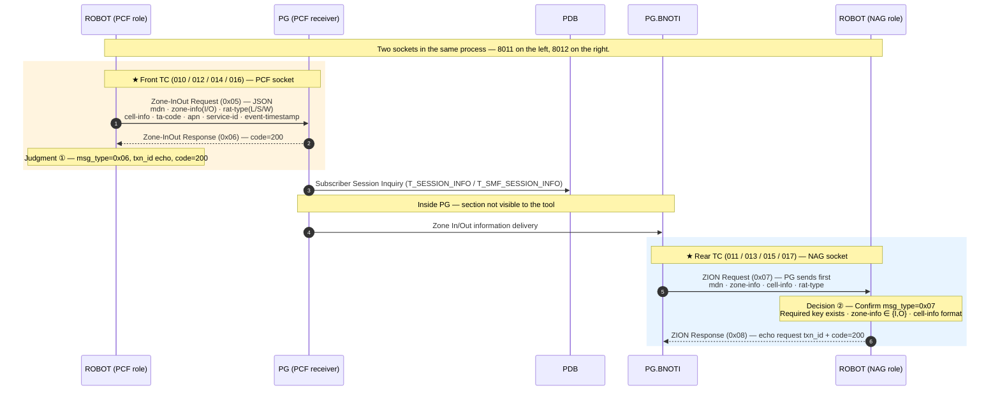
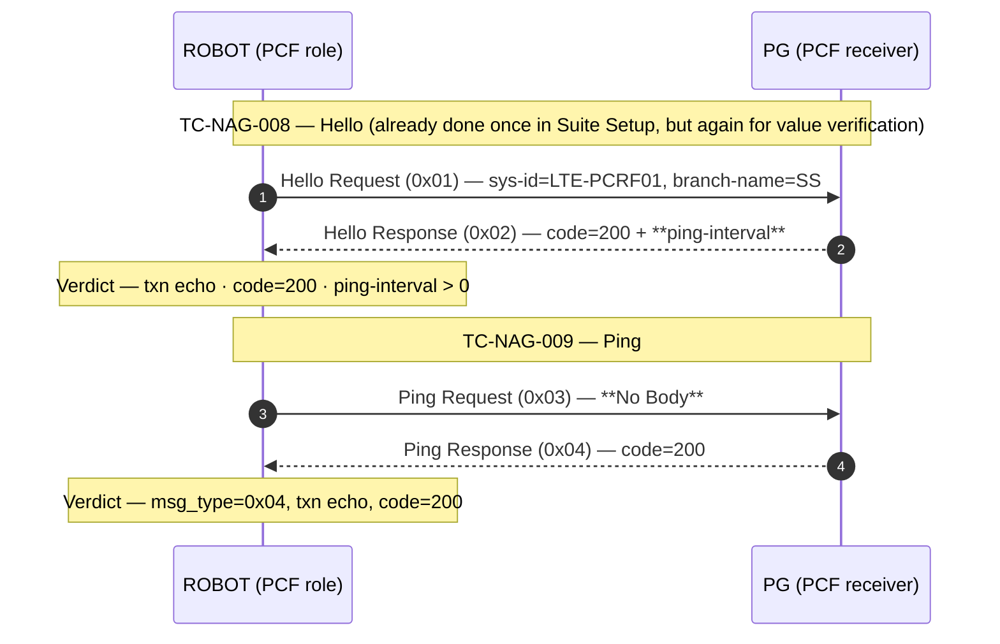

# PCF — ZONE Notification (Zone-InOut ↔ ZION)

| item | value |
|---|---|
| tool role | PCF/PCRF (Client) → PG:`${PCF_PG_PORT}`(8011) — However, two sockets are  |
| auxiliary socket | NAG (Client) → PG:`${NAG_PG_PORT}`(8012) — Subscriber session pre-registration + ZION reception |
| flagship message | Zone-InOut Request(0x05) ↔ Response(0x06) — PCF socket |
| reverse | ZION Request(0x07) ↔ Response(0x08) — NAG Socket (PG sends first) |
| secondary message | Hello(0x01/0x02) · Ping(0x03/0x04) — `TC-NAG-008` / `TC-NAG-009` |
| Body | JSON, 8-octet common header (Byte0 `0x00`) |
| Judgment | Reply `code=200` + `txn_id` echo + ZION does it actually come back |

> ⚠ This node's PG round trip spans two sockets. The request goes out to the PCF socket (8011) and the resulting
> ZION comes into the NAG socket (8012). This is why the suite opens two sockets,
> This is why the TC number is `TC-NAG-*` and not `TC-PCF-*`.

> `0x05`/`0x06` has a completely different meaning from  in LRS (Location-Info) · UPM (Subs-Change).
> Instead of writing the numbers directly, write `${MSG_PCF_ZONE_REQ}` / `${MSG_PCF_ZONE_RESP}`
> ([INTERFACES.md opcode conflict table](../INTERFACES.md)).

## Suite Setup — Dual sockets, fixed order

`Suite Connect With NAG` adds NAG first, then . In order for PG to issue a zone notification, the subscriber's
Since the session must be registered, if you only open the PCF socket, 0x05 does not receive ZION even if it receives 200.



`txn_id` means that both sockets have one global counter (`Next TXN ID`) share. Divided by socket
Therefore, you should not judge which channel it is by just looking at the txn value in the log.

## PG process list

| process | What you do | startup flag |
|---|---|---|
| `CDS201` | Pre-start required — `PG.CDS` loads ZONE notification target subscriber data (same reason as NAG/LRS, user confirmation) | `/PG/BIN/PDB_RUN/CDS201.RUN` |

`Suite Connect With NAG` wakes up `Ensure PG Process Running` before opening the socket (SSH
If there is no account information, it will be quietly skipped — see `ssh_keywords.robot`).

## Callflow — Zone-InOut + ZION (main)

It is the main body of the suite. One logical flow is split into two TCs — TC sending 0x05 and
As a result, the TC receiving ZION is even.



`Receive ZION Request` is blocking reception (`${PCF_TIMEOUT}`=10 seconds). If ZION doesn't come, that TC
Fails on timeout — this is the only way for this node to determine that "the PG actually issued a notification."

## TC pairing — which TC receives the result of which TC

| Sending TC (PCF 8011) | Receiving TC (NAG 8012) | scenario | main value |
|---|---|---|---|
| `TC-NAG-010` | `TC-NAG-011` | Zone IN / LTE | `zone-info=I` `rat-type=L` `ta-code=3113`(Hexa 4) |
| `TC-NAG-012` | `TC-NAG-013` | Zone OUT / 5G | `zone-info=O` `rat-type=S` `ta-code=0` · sys-id `SPCF0001` |
| `TC-NAG-014` | `TC-NAG-015` | Zone IN / 3G third-party network | `zone-info=I` `rat-type=W` `cell-info=45006-9999:99` `ta-code=008461`(Hexa 6) |
| `TC-NAG-016` | `TC-NAG-017` | Zone IN/txn echo verification | Same value as 010, specify `Next TXN ID` |

`rat-type` — `L`(LTE) / `S`(5G SA) / `W`(3G WCDMA).
`cell-info` — `NodeB:Cell`, `plmn-NodeB:Cell` (`Cell Info Should Be Valid` regular expression) for other networks.
`ta-code` — Zone IN is 4 or 6 hexa digits, Zone OUT is `0`.

## Callflow — Hello / Ping



## Position in the HFC service flow

[HFC Call Flow](../INTERFACES.md#hfc-service-call-flow--how-the-three-nodes-connect) in INTERFACES.md
The bottom two arrows — `PCF → PG.BNOTI` and `PG.BNOTI → NAG` — are the sections covered by this suite.

```
CDS 1X/1Y → PG.CDS → PDB → PG.SDM/PG.BSUBS → UPM Cell List round trip
                                    ↓
                          Cell list notification to PCF (RBUS/SBI)
                                    ↓
        ┌─────────── PCF suite takes care of it from here ───────────┐
        │  PCF → PG.BNOTI : Zone In/Out (0x05/0x06)        │
        │  PG.BNOTI → NAG : ZION (0x07/0x08)               │
        └──────────────────────────────────────────────────┘
```

Unlike other suites, one suite sees both ends of the PG round trip. Dual sockets make that possible —
This is in contrast to the UPM suite passively receiving only `Cell List Request`.

However, INTERFACES.md is `PG.BNOTI → NAG` The arrow indicates ZION(`0x07`) to "estimate" whether it is the same as
It is showing. The suite document (`TC-NAG-010`) states, "PG sends ZION-Request (0x07) to NAG after receiving Zone IN.
Since it is asserted as “sent,” one of these two needs to be sorted out.

## TC Reference

TC ordering, notification pairing, and assertion limits are maintained in the
[PCF node specification](../../tests/pcf/AGENTS.md#execution-dependencies-and-assertion-limits).
This developer reference explains the internal flow and does not own TC requirements.

## Related documents

- [PCF Node Specification](../../tests/pcf/AGENTS.md) — Connection·Message Type·Dual Socket Policy
- [NAG node specification](../../tests/nag/AGENTS.md) — ZION (0x07/0x08) definition, NAG channel full message
- [INTERFACES.md](../INTERFACES.md) — opcode conflict table, HFC service Call Flow
- `tests/pcf/pcf_tests.robot` — `TC-NAG-008`~`017` (10 cases)
- `resources/pcf_keywords.robot` · `resources/nag_keywords.robot` — Transmission/reception/ZION implementation
