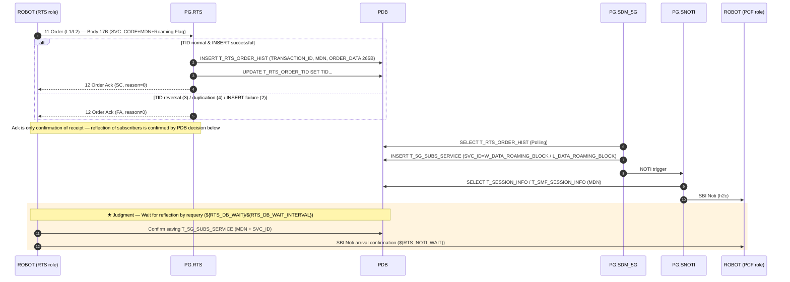

# RTS `L1`/`L2` — Roaming data blocking

| item | value |
|---|---|
| SVC_CODE | `L1`(→ SVC_ID=`W_DATA_ROAMING_BLOCK`) / `L2`(→ SVC_ID=`L_DATA_ROAMING_BLOCK`) |
| test case | `TC-RTS-001` (block WCDMA) / `002` (disable WCDMA) / `003` (block LTE) / `004` (disable LTE) |
| Notification Path | `PG.SDM_5G` → `PG.SNOTI` → PCF (SBI Noti) — User confirmation |
| Notification verdict | `Verify RTS SBI Noti Sent` confirms arrival |
| UPM integration | None |
| Body width | 17B (this range) — wire offset 0 (SVC_CODE)/2 (MDN)/14 (roaming flags) |

> ⚠ RTS is a separate interface from “PG.RDS” (coupon reservation task poller) in the CDS document. Because the names are similar
> This node was added due to confusion — never treat them as the same thing ([../../tests/rts/AGENTS.md](../../tests/rts/SPEC.md)).

> L1/L2 is not an ON/OFF pair, but a  network type (user confirmation, 2026-10-27) — L1=WCDMA, L2=LTE.
> Blocking/unblocking is determined by roaming flags (`Y`/`N`) rather than codes. The diagram below shows the two codes
> Since they are structurally the same, they are combined into one (only the values that change are separated in the table).

## PG process list

Check startup before running the suite. The name is based on `/PG/CFG/ST.cfg`.

| process | Participants in the diagram | What you do |
|---|---|---|
| `RTS201` | `PG.RTS` | Order(`11`) received, `T_RTS_ORDER_HIST` loaded, Ack(`12`) responded |
| `P_SDM601` | `PG.SDM_5G` | History polling → Reflection of `T_5G_SUBS_SERVICE` → RBUS NOTI |
| `SNOTI501` | `PG.SNOTI` | SBI Noti to PCF after session inquiry |

The latter two are the same process as the CDS flow ([cds_callflow.md](cds_callflow.md#pg-process-list)).
So `P_SDM601` Ina `SNOTI501` If this dies, RTS and CDS collapse together — RTS only
If you fail, look towards `RTS201`, and if both fail, look behind you.

`12 Order Ack` gives `RTS201`. So even if Ack is `SC`, if `P_SDM601` is dead, then
Subscriber reflection and notification do not occur at all — it is only revealed in the PDB decision below.
`R_SDM601`, which is in charge of CDS coupon expiration, is not involved in this flow.

## call flow

## Code-specific values

| TC | SVC_CODE(Network) | action | Roaming flag (wire offset14 / DB offset 85) | SVC_ID |
|---|---|---|---|---|
| 001 | `L1` (WCDMA) | block | `Y` / `Y` | `W_DATA_ROAMING_BLOCK` Confirmed 1 or more cases |
| 002 | `L1` (WCDMA) | off | `N` / `N` | Not confirmed (unconfirmed when deactivated) |
| 003 | `L2` (LTE) | block | `Y` / `Y` | `L_DATA_ROAMING_BLOCK` Confirmed 1 or more cases |
| 004 | `L2` (LTE) | off | `N` / `N` | Not confirmed (unconfirmed when deactivated) |

Wire (receive) offset and DB storage offset are different — 14 / 85 respectively. `T_RTS_ORDER_HIST.ORDER_DATA`
This is because PG is a separate buffer that is reassembled into 265B. For details, see [../../tests/rts/AGENTS.md](../../tests/rts/SPEC.md#wire-encoding-two-offset-systems).

## Judgment criteria

`12 Order Ack` only carries InsertOrder success or failure — only when `InsertOrder` actually succeeds
Giving `SC` is more reliable than CDS `CommandResult`, but the body content (SVC/roaming flag) is
It is the same as CDS in that even if something goes wrong, if the INSERT itself succeeds, `SC` comes out. Subscriber service table reflection
Since `PG.SDM_5G` polls later, it is determined only as PDB.

- `T_RTS_ORDER_HIST.ORDER_DATA[85]` (SQL `SUBSTR(ORDER_DATA, 86, 1)`) = requested roaming flag — protocol layer (common to TC-RTS-001~004)
- `T_5G_SUBS_SERVICE`(MDN, SVC_ID) = 1 more than  — Business layer (block TC-RTS-001/003 only, user confirmed). Clear TC-RTS-002/004 is not viewed because row processing (delete/remaining) is not confirmed.
- `Verify RTS SBI Noti Sent` — Whether PCF SBI Noti has arrived (confirmed by user)

`PG.SDM_5G` is exactly what process it is (`SDM_5G/OrderDataReader.cpp` is `T_RTS_ORDER_HIST`
The reading code was confirmed, but the entire processing after that was outside the scope of the investigation) and the delay time until reflection was
Need confirmation — Currently, `${RTS_DB_WAIT}`/`${RTS_NOTI_WAIT}` are estimates referring to CDS values.

TC-RTS-005(negative, packet size verification) does not use the above callflow — Data Size header field
A false report was made larger than the actual body and an Order Ack (FA, REASON=`E_WRONG_SIZE`) was received immediately at the `RTS201` stage.
=12), so the PDB/Noti flow itself after `InsertOrder` should not occur.
It's normal. For details, see [../../tests/rts/AGENTS.md](../../tests/rts/SPEC.md).

## Related documents

- [RTS Node Spec](../../tests/rts/SPEC.md) — Encoding table, double offset, pitfalls, verification required
- `tests/rts/rts_tests.robot` — `TC-RTS-001`~`004` (WCDMA/LTE block/unblock) / `TC-RTS-005` (negative)
