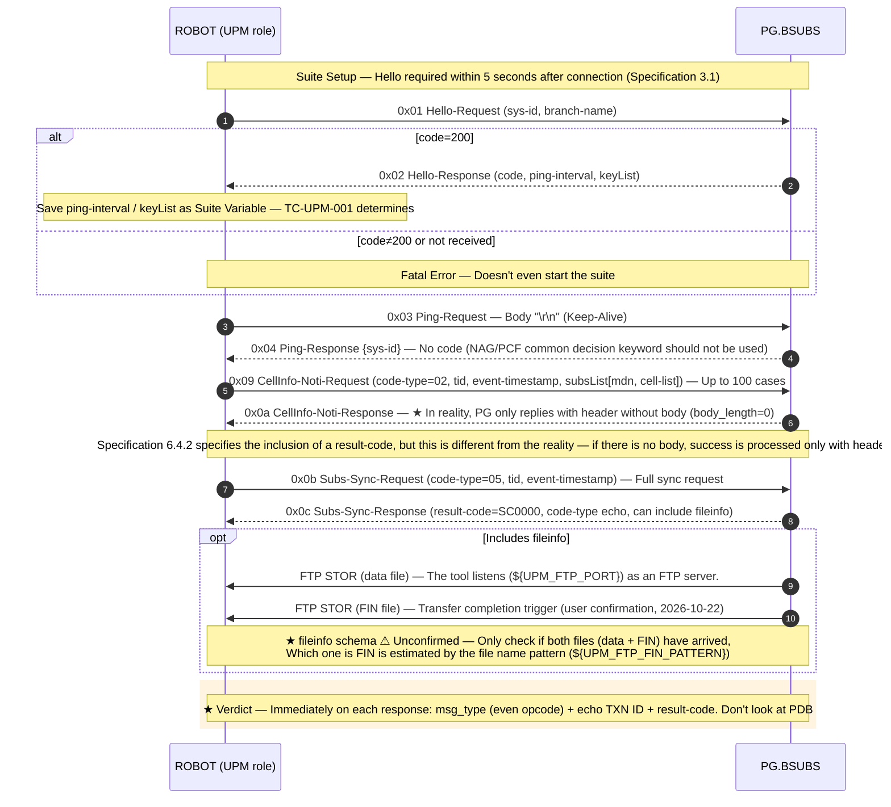
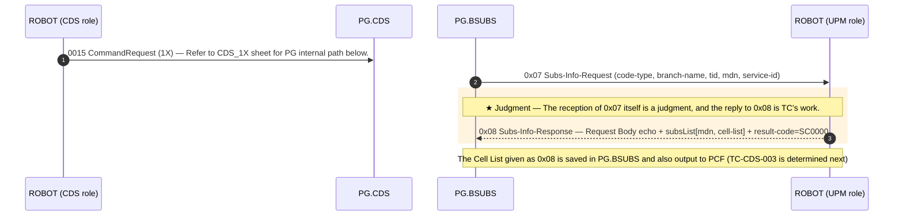

# UPM — HFC service integration (UPM ↔ PG.BSUBS)

| item | value |
|---|---|
| tool role | UPM (Client) → PG:`${UPM_PG_PORT}`(10506), single socket |
| Header / Body | 8-octet common header (Byte0 `0x00`) / JSON |
| direction | Bidirectional — 4 types of active transmission (Hello/Ping/CellInfo-Noti/Subs-Sync) + 3 types of passive reception (Subs-Change/Subs-Info/Info-Change) |
| Hello pharmaceutical | If Hello is not sent within 5 seconds after connection, PG disconnects. (Specification 3.1) — Suite Setup handles this. |
| Judgment | Response immediate decision — `msg_type` + `txn_id` echo + `result-code=SC0000` (PDB no decision ) |
| Passive receiving TC | PG side event (CDS business code) triggers — runs in CDS suite, not UPM suite (table below) |

> ⚠ `0x05`·`0x07`·`0x09`·`0x0b` have completely different meanings in different nodes —
> [opcode conflict table](../INTERFACES.md#opcode-conflict--use-the-constant-name-for-each-node-as-is). instead of numbers
> Use the `${MSG_UPM_*}` constant. Also, `tid` (24-character string) in JSON Body is in the header.
> `txn_id` (4B binary) and  are completely separate ([../../tests/upm/AGENTS.md](../../tests/upm/AGENTS.md#tid--separate-from-txn_id)).

> ⚠ The schema of the `fileinfo`  field itself of 0x0c (file name/size, etc.) is still unconfirmed —
> The original text of specification 6.6.1/6.6.2 is not available in this repo. However, FTP connection information (host/port/account/
> remote path) was confirmed with PG settings(`SYSTEM_ID_04=UPM-R0`(changed on 2026-10-28, previously UPMROB). From 2026-10-29, dev is `UPM-R2`(SFTP), 2026-10-22 —
> [see "fileinfo (0x0c)" section in ../../tests/upm/AGENTS.md](../../tests/upm/AGENTS.md)) — PG is FTP
> The direction of pushing to the client has also been confirmed. The transfer file is  data file + FIN
> The user also confirmed that there are two files (2026-10-22) — but which file is FIN?
> (naming convention) and fileinfo content matching is still the best-effort.
>
> In an environment where `USE_SFTP_04` in PG settings is changed to `Y` instead of `N` (plain text FTP)
> You can launch the same receiving server via SFTP with `${UPM_FTP_USE_SFTP}` — ⚠ Not verified,
> See the “SFTP Alternatives” section in [../../tests/upm/AGENTS.md](../../tests/upm/AGENTS.md).

## Callflow — Active Transmission (UPM suite, TC-UPM-001~004)

## Callflow — Manual reception (PG.BSUBS → UPM, trigger is CDS)

The three types of passive reception require an actual event (subscription, cancellation, change) from the PG side. Holding that trigger
CDS The business code is , so if you leave it in the UPM suite, it will just wait forever and time out — which actually works.
The section has been moved to CDS suite (this is also in each sheet of [cds_callflow.md](cds_callflow.md))
A round trip is depicted).

| Trigger (CDS Code) | PG.BSUBS → UPM | UPM → PG.BSUBS (response) | TC to verify |
|---|---|---|---|
| Join `1X` HFC | `0x07` Subs-Info-Request | `0x08` — Reply  with Cell List | `TC-CDS-003` (CDS suite) |
| `1Y` HFC termination | `0x07` Subs-Info-Request | `0x08` — Termination is also used to clean up cells. | `TC-CDS-004` (CDS suite) |
| `C1`/`G1` change/information change | `0x0d` Info-Change-Request | `0x0e` — mdn echo | `TC-UPM-311` (Note) |
| `D3` change number | `0x05` Subs-Change-Request | `0x06` — echo mdn/new-mdn | `TC-UPM-321` (Note) |

For `C1`/`G1`/`D3`,  BSUBS↔UPM round trip occurs only when you are subscribed to HFC — If you are not subscribed, this
There is no section itself ([cds_callflow.md](cds_callflow.md) rule 2).

All three types of passive reception look the same — `code-type`/`branch-name`/`tid`/`mdn` in the request body.
echo `result-code=SC0000` in the request header `txn_id` Reply with If you don't send a response
Since the flow on the PG side is not complete, the tool's work is  until the  reply.

> ⚠ The commented out `TC-UPM-399` says "1Y(code-type=03) has no UPM request/response".
> In reality, `TC-CDS-004` is determining the reception of 1Y `0x07` — The comment is outdated. Try to revive it
> When doing this, check this discrepancy first.

## Judgment criteria

- 4 types of active transmission — Since the response always comes, it is decided immediately: `msg_type` (even opcode of request + 1),
  `txn_id` echo, `result-code=SC0000`(`${UPM_RC_SUCCESS}`), `code-type` echo.
  Exception two: The Ping response is only `{sys-id}`, so there is no code verification, and the CellInfo-Noti response has no body.
  It can be accessed and is processed successfully with just a header ACK.
- Three types of manual reception — Reception (opcode·code-type·mdn format) + normal response transmission is all that determines.
- PDB No verdict — Subscriber table reflection is not a concern of the UPM interface. HFC message
  PDB judgment (`T_5G_SUBS_SERVICE`/`T_BAROD_SUBS_CELLINFO`) is made by the CDS suite.

## Related documents

- [UPM node specification](../../tests/upm/AGENTS.md) — message type table, tid creation rules, code-type, pitfalls
- [cds_callflow.md](cds_callflow.md) — Trigger side flow (CDS_1X / CDS_1Y / CDS_C1 / CDS_G1 / CDS_D3 sheets)
- `tests/upm/upm_tests.robot` — `TC-UPM-001`~`004` (active) / 311·321·399 (commentary)
- `resources/upm_keywords.robot` — Transmission/reception/echo response implementation
