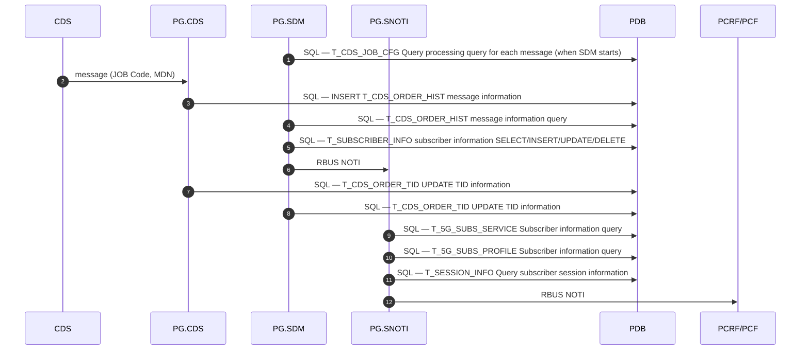
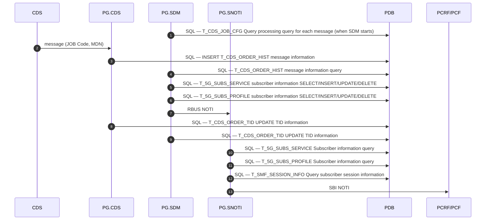
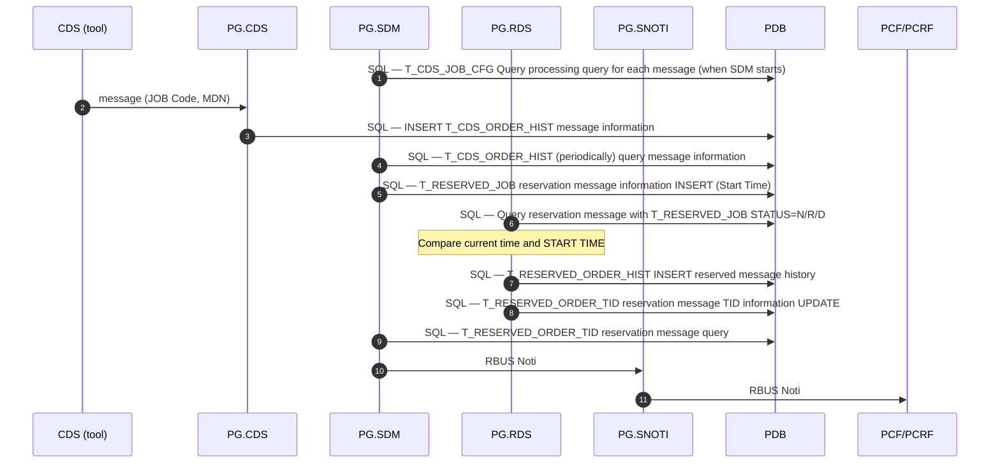

# CDS Test Instructions

Read the [shared test guide](../AGENTS.md), [TC conventions](../TC_CONVENTION.md)
before editing. The node specification is included below.

Keep Rchannel-before-Schannel setup and DB assertions. The current stateful TC dependencies are legacy independence gaps, not a pattern for new tests. CommandResult SC does not prove subscriber application. Inspect the 021–028 chain before selecting individual cases.

- Suite: `cds_tests.robot`; keywords and variables are under `resources/`.
- Use the specification's implementation links and shared references for the affected behavior.
- Structural check from the repository root: `python -m robot -V config/env/dev.py --dryrun --outputdir /tmp/tc4robot-cds-dryrun tests/cds/`.
- Runtime or live integration checks are additional evidence; do not treat a dry run as proof of business correctness.

---

## Node Specification

### TC Authoring Entry Point

- [TC conventions](../TC_CONVENTION.md) · [Validation workflow](../../docs/agent/workflow.md)
- Test suite: [`cds_tests.robot`](cds_tests.robot)
- Keywords: [`cds_keywords.robot`](../../resources/cds_keywords.robot)
- Variables: [`cds_variables.robot`](../../resources/cds_variables.robot)
- Python libraries: [`CdsHelper.py`](../../libraries/CdsHelper.py) · [`PdbHelper.py`](../../libraries/PdbHelper.py) · [`HttpNotiServer.py`](../../libraries/HttpNotiServer.py)
- Shared references: [PDB](../../docs/shared/PDB.md) · [SBI_NOTI](../../docs/shared/SBI_NOTI.md) · [SSH](../../docs/shared/SSH.md)

Rchannel connects before Schannel. PDB is required during suite setup. Cases 021–028 contain stateful subscriber-number and HFC dependencies; consult the dependency section before selecting tests.

Use the sections below for message inputs, assertions, dependencies, and known limits.
Developer call-flow documents are optional background and are not prerequisites for TC authoring.

Specification: `CDS Standard Interface Specification Ver6.0`
File: [`cds_tests.robot`](cds_tests.robot) · [`cds_keywords.robot`](../../resources/cds_keywords.robot) · [`cds_variables.robot`](../../resources/cds_variables.robot) · [`CdsHelper.py`](../../libraries/CdsHelper.py)

### Connection — Dual socket, Rchannel first

| item | value |
|---|---|
| tool role | CDS (Active Connector) |
| direction | Tools → PG.CDS |
| Schannel | `${CDS_SCH_PORT}` = 9200 |
| Rchannel | `${CDS_RCH_PORT}` = 9201 |
| header | 48-octet big-endian |
| Body | fixed message |
| time out | `${CDS_TIMEOUT}` = 10 seconds |

The connection order is fixed — Rchannel is opened first.

| order | channel | send | expectations |
|---|---|---|---|
| 1 | Rchannel 9201 | `0003` RchannelConnectionRequest | `0004` ACK |
| 2 | Schannel 9200 | `0001` SchannelConnectionRequest | `0002` ACK |

Connection and disconnection are not TC, but Suite Setup / Teardown.

| | keyword | What you do |
|---|---|---|
| Suite Setup | `Suite CDS Connect` | Rch connection → `0003`/`0004` → Sch connection → `0001`/`0002` → Check the survival of both sockets |
| Suite Teardown | `Suite CDS Disconnect` | Sch `0005`→`0006` verification → Rch `0007`→`0008` verification → Socket termination |

If setup fails, the suite does not stand, so there is no need to reconfirm the connection with TC. Even if it is released
This is something that must be done after the suite is finished, so if you set it to TC, it will be skipped in case of failure or filtering.

Teardown does not reverse the order, but sends  Release in the order of Schannel→Rchannel and then closes.
`Send Release And Validate` verifies msg_id and `Result=SC` of the ACK,
If the PG hangs up without ACK, it is considered normal release (allowed by the standard).

In fact, PG.CDS actually hangs up without ACK. The logs for this path are `INFO` and  — used to be `WARN`
So, for each run, two cases `Release(5)` / `Release(7)` appeared in the warning at the top of the report.
It was taken down because it was inconsistent to raise a warning to a path that the code declared itself to be "considered normal release."
Since the trace is the same, it is possible to distinguish whether ACK is received at `log.html`.

Do not wrap the ACK verification in `Run Keyword And Ignore Error` — wrapping it will disable the verification.
Robot continues to execute the rest even if the keyword in the teardown fails, so socket termination is not possible anyway.
It is carried out. In fact, it was confirmed to be a fake PG that returned Release ACK as `FA`: both channels
A failure was reported, and the socket was nonetheless closed.

Port and `${CDS_DST_SYS_ID}` (PG.CDS SYSTEM_ID, default `PG01`) is `cds_variables.robot` default,
If it is different for each environment, override in `config/env/<env>.py`.
Upload-only ports `${CDS_UP_SCH_PORT}` (6100) / `${CDS_UP_RCH_PORT}` (6101) are also defined.

### Message type

| ID | name | ID | name |
|---|---|---|---|
| `0001`/`0002` | SchannelConnectionRequest / ACK | `0017`/`0018` | CommandResult / ACK |
| `0003`/`0004` | RchannelConnectionRequest / ACK | `0025`/`0026` | UploadRequest / ACK |
| `0005`/`0006` | SchannelReleaseRequest / ACK | `0027`/`0028` | UploadResult / ACK |
| `0007`/`0008` | RchannelReleaseRequest / ACK | `0029`/`0030` | SubsDataRequest / ACK |
| `0013`/`0014` | ProcessStateRequest / ACK | `0031`/`0032` | SubsDataResult / ACK |
| `0015`/`0016` | CommandRequest / ACK | | |

Process State values: `${CDS_PS_NORMAL}`=1 / `${CDS_PS_ABNORMAL}`=2, `uint16` big-endian
(`pack_process_state` / `unpack_process_state`).

### Call Flow — PG internal processing

Developer background. For TC work, start with the entry point above, the TC dependency section, and the code-specific PDB assertions.

The section that the tool verifies is only the first arrow (`Message(JOB Code, MDN)`). Everything after that is PG.
It is internal and not visible in the tool. Whether the message was actually reflected can only be confirmed in the PDB table —
This is because `CommandResult` comes as `SC` regardless of the body contents (see [Trap](#body-encoding-regression-cannot-be-caught-automatically) below).

The message is divided into  immediate / reserved  and LTE / SA subscribers respectively — the two diagrams below
[Cover all four cases with the difference table ](#ltesa-differences--only-table-names-and-noti-method).
The HFC (`1X`/`1Y`) flow where CDS spans multiple nodes is in [INTERFACES.md](../../docs/INTERFACES.md#hfc-service-call-flow--how-the-three-nodes-connect).

Source: `PG (PCF Gateway) Training Materials` Chapter 03 — *02. Operation Flow* for each PG service.

#### LTE subscribers



#### SA Subscriber



#### Reservation message — RDS holds until START TIME

In the reservation message, PG.RDS is additionally added.  SDM does not process it immediately, but sends it to `T_RESERVED_JOB`.
If you put it together with Start Time, RDS rotates to `STATUS=N/R/D` and displays the current time and START TIME of .
Compare  and execute when the time is right. Use `T_RESERVED_ORDER_TID` instead of `T_CDS_ORDER_TID`.



#### LTE/SA Differences — Only Table Names and NOTI Method

The stages and order of the flow are completely the same for LTE and SA. In the diagram above, only the names below are changed.

| flow | item | LTE | SA |
|---|---|---|---|
| immediately | Update SDM subscriber information | `T_SUBSCRIBER_INFO` (1 unit) | `T_5G_SUBS_SERVICE` + `T_5G_SUBS_PROFILE` (2) |
| immediately | SNOTI session information inquiry | `T_SESSION_INFO` | `T_SMF_SESSION_INFO` |
| Reservation | reservation queue | `T_RESERVED_JOB` | `T_5G_RESERVED_JOB` |
| Reservation | Reservation history | `T_RESERVED_ORDER_HIST` | `T_5G_RESERVED_ORDER_HIST` |
| Reservation | Reservation TID | `T_RESERVED_ORDER_TID` | `T_5G_RESERVED_ORDER_TID` |
| common | PCF/PCRF Notice | RBUS Noti | SBI Noti |

`T_CDS_JOB_CFG` · `T_CDS_ORDER_HIST` is LTE/SA common. In the SDM → SNOTI section, SA is also RBUS Noti,
What changes is the last section of SNOTI→PCF/PCRF..

In the immediate message, SNOTI's subscriber information inquiry shows LTE also `T_5G_SUBS_SERVICE` / `T_5G_SUBS_PROFILE`
— It is different from the table used by SDM (`T_SUBSCRIBER_INFO`).

☞ Some messages are not NOTIed with PCF/PCRF.  This is a clue attached to all four flows.
List confirmed (2026-08-19): There are only three: `A1` · `1Y` · `Z1`, all remaining codes will be released.

| code | Notification with PCF | Remarks |
|---|---|---|
| New registration for `A1` / Cancellation for `Z1` | I'm not going out | Tools skip judgment |
| everything else | go out | Each TC determines arrival as `Verify SBI Noti Sent` |

`1X`·`1Y` is no exception — `SDM → SNOTI` RBUS NOTI does not go out SDM subscriber
There is no notification , but BSUBS wakes up SNOTI (Rule 1). `TC-CDS-003`/`004` respectively
Judge.

##### Process for creating notifications — split by code + HFC subscription status (2026-08-19)

Whether notifications are sent out and who creates them are two different issues. The latter has three rules from the top.
It is determined by applying them sequentially. The same `Z1` uses BSUBS when subscribed to HFC, and when unsubscribed,
Take the SDM.

| business code | Join HFC | Not subscribed to HFC | rules |
|---|---|---|---|
| `1X` · `1Y` | BSUBS(`T_BAROD_ORDER_HIST`) | BSUBS(`T_BAROD_ORDER_HIST`) | 1 — unconditionally |
| `D3` · `C1` · `G1` · `Z1` | BSUBS(`T_BAROD_ORDER_HIST`) | SDM(`T_CDS_ORDER_HIST`) | 2 — Divided into states |
| Everything else (`A1` `I2` `I3` `K1~K6` `Y9` `SS` `ST` …) | SDM(`T_CDS_ORDER_HIST`) | SDM(`T_CDS_ORDER_HIST`) | 3 |

This table is based on "HIST table processing" — not the same as "Notify with SNOTI". `C1`/`G1`/`D3`
In HFC subscription state, BSUBS polls `T_BAROD_ORDER_HIST` and processes it (UPM round trip),
Not notified by SNOTI (confirmed, 2026-10-16 — see " below`C1`/`G1` If you are also subscribed to HFC, use UPM
(Refer to the section "Target"). The actual notification is made unconditionally by SDM. `doNoti()` Just one stopover. Rule 2
The code that is literally satisfactory (BSUBS does both processing and notification) is the only code I've seen so far.
There is none — BSUBS The only thing that BSUBS announces as SNOTI is Rule 1 (`1X`/`1Y`, unconditionally).

The two paths join at `PG.SNOTI`. What a tool receives as a PCF role is the same either way.
SBI Noti is The path cannot be distinguished just by receiving it. So the suite determines the expected path as a rule.
Calculate it and put it in the failure message — it is printed as `SBI Noti (Z1, via SDM / HFC=False)`,
When you don't receive it, you are immediately divided on whether to look at BSUBS (polling/UPM round trip) or SDM.

Tool-side implementation:
`@{CDS_NOTI_BSUBS_ALWAYS}`(1X·1Y) / `@{CDS_NOTI_BSUBS_IF_HFC}`(D3·C1·G1·Z1) /
`${CDS_HFC_SUBSCRIBED}` (1X turns on, 1Y turns off) → `Expected Noti Route` keyword.

★ The "expected path" label calculated by `@{CDS_NOTI_BSUBS_IF_HFC}` is found above for `C1`/`G1`
It is the same as before (if you are subscribed to HFC, enter “via BSUBS”) — `Verify SBI Noti Sent` is
Since we only see “1 or more arrivals”, the decision (pass/fail) itself is not affected, but the failure message
The path label may be wrong now. To change up to the  label, change from `cds_variables.robot` to `C1`/`G1`
We need to remove it from this list and fix the branching of the `Expected Noti Route` keyword — not yet reflected.

> ⚠️ In the current suite order, there is no TC riding the BSUBS branch of Rule 2.
> After `1Y`(004) cancels HFC, `C1`(007), `G1`(015), `D3`(027), and `Z1`(028) appear.
> Therefore, all four are judged to be via SDM. To cover that branch, you can either push back `1Y` or move that TC
> You need to send `1X` one more time, but both  touch the dependency between TCs.

The tools side list is held by one `@{CDS_NOTI_EXEMPT_CODES}` (cds_variables.robot) —
If the list changes, you only need to change the variable, and  TC just passes its own business code.
If the TID is updated but the PCF is not reflected, this list should be questioned first.

##### There are two HIST tables — the HFC branch of rule 2 is determined here

When a message comes into PG.CDS, it can be INSERTed into both HIST tables. The target is different.

| table | target code | condition |
|---|---|---|
| `T_CDS_ORDER_HIST` | All Codes | INSERT unconditionally |
| `T_BAROD_ORDER_HIST` | `1X` `1Y` `D3` `C1` `G1` `Z1` | `1X`/`1Y` is unconditional, `D3`/`C1`/`G1`/`Z1` silver`1X`Only if you are already registered with (HFC subscription) |

Polling is also divided by table. — SDM uses `T_CDS_ORDER_HIST`, and BSUBS uses
Poll `T_BAROD_ORDER_HIST`. If rule 2 above (`D3`/`C1`/`G1`/`Z1` is subscribed to HFC)
BSUBS, or SDM) is determined by INSERT — these four codes are
When it comes in, there is nothing accumulated in `T_BAROD_ORDER_HIST`, so there is nothing for BSUBS to poll, so
Take the SDM route.

INSERT (write) and SELECT (polling, read) have separate settings. — You should not mix the two.

| Settings | meaning | `Y` | `N` |
|---|---|---|---|
| `ALTIBASE_USE` | HIST table INSERT target | Altibase + Goldilocks both sides (`bUseAltibase_=true`, `bUseGdilcks_=true`) | Goldilocks only (`bUseAltibase_=false`, `bUseGdilcks_=true`) — Goldilocks INSERT is always on regardless of this value |
| `PCRF_SUPPORT` | SDM/BSUBS polling SELECT source | SELECT (`bSelectAltibase_=true`) from Altibase | SELECT from Goldilocks (`bSelectAltibase_=false`) |

In other words, even if `ALTIBASE_USE=N` is set to `PCRF_SUPPORT=Y`, SDM/BSUBS uses Altibase.
I'm trying to SELECT, but there's nothing in that table. — The reflection won't be visible forever.
It appears as a symptom. To check whether the same row is visible no matter which DB you query, use these two settings.
You should watch  like .

Actual measured value (by environment):

| environment | `PCRF_SUPPORT` | `ALTIBASE_USE` | influence |
|---|---|---|---|
| DEV | `N` | `N` | Goldilocks only for both writing and reading — consistent, no symptoms |
| TB | `N` | `Y` | Writing is on both sides, reading is just Goldilocks — it's out of alignment, but it's always in Goldilocks, so there are no symptoms. |

Both environments are `PCRF_SUPPORT=N`, so I haven't actually experienced the above "forever invisible" symptom.
There is no. If there is an environment where  changes to `PCRF_SUPPORT=Y`, then the `ALTIBASE_USE` value must be changed.
Check — If `N`, the symptom is reproduced.

#### Implications from a tool perspective

| flow | What the tool can see |
|---|---|
| `Message → PG.CDS` | `CommandResult`(`SC`/`FA`) — `SC` regardless of Body content |
| Everything after `PG.CDS → PDB` | None. Cannot be determined without PDB inquiry |

So, the TC with the tag `db` is judged by directly querying the PDB. Among the 12  messages
All 11  except `TC-CDS-001`(ProcessState) correspond here — only `001` message
Completed with flow.

#### PDB judgment criteria (by business code)

Add a judgment keyword after `Command Download Flow`. The standards are three-pronged.

| TC | code | keyword | success condition |
|---|---|---|---|
| 002 | A1 New sign up | `Verify Subscriber Provisioned In PDB` | 1 PROFILE + 2 SERVICE cases are all `1` |
| 003 / 010 | 1X HFC subscription | `Verify Zone Service Subscribed In PDB` | `1`Gun abnormal |
| 004 / 011 | 1Y HFC cancellation | `Verify Zone Service Released In PDB` | `0`gun |
| 005 | I2 Additional service application | `Verify Addon Service Subscribed In PDB` | `1`Gun abnormal |
| 006 | I3 Additional Service Cancellation | `Verify Addon Service Released In PDB` | `0`gun |
| 007 / 008 / 009 | C1 / G1 / D3 | `Verify Service Counts Preserved In PDB` | Perform Before and after `SVC_ID` The number of rows is the same |
| 012 | Cancel Z1 subscription | `Verify Subscriber Removed From PDB` | PROFILE / SERVICE is all `0` |

```sql
-- 002 A1: What does it look like?
SELECT COUNT(*) FROM T_5G_SUBS_PROFILE WHERE MDN = ?
SELECT COUNT(*) FROM T_5G_SUBS_SERVICE WHERE MDN = ? AND SVC_ID = 'DATA_USAGE_LEVEL'
SELECT COUNT(*) FROM T_5G_SUBS_SERVICE WHERE MDN = ? AND SVC_ID = 'DATA_USAGE_LEVEL_2'

-- 003/010 1X: Zone service attached → 1 or more cases
SELECT COUNT(*) FROM T_5G_SUBS_SERVICE
 WHERE MDN = ? AND SVC_ID = 'ZONE_SVC_D' AND SVC_TYPE = 'D' AND JOB_CODE = '1X'

-- 004/011 1Y: Zone service has declined → 0 cases
SELECT COUNT(*) FROM T_5G_SUBS_SERVICE WHERE MDN = ? AND SVC_ID = 'ZONE_SVC_D'

-- 005 I2: Is there an additional service? → 1 or more (TIME_PERIOD_ID is not looked at)
SELECT COUNT(*) FROM T_5G_SUBS_SERVICE
 WHERE MDN = ? AND SVC_ID = 'YOUNG_HARM_INFO_BLOCK' AND SVC_TYPE = 'N'
       AND JOB_CODE = 'I2' AND "LIMIT" = 'Y'

-- 006 I3: Are additional services missing → 0 cases?
SELECT COUNT(*) FROM T_5G_SUBS_SERVICE WHERE MDN = ? AND SVC_ID = 'YOUNG_HARM_INFO_BLOCK'

-- 007/008/009 C1·G1·D3: Is the tally before and after execution the same?
SELECT SVC_ID, COUNT(*) FROM T_5G_SUBS_SERVICE WHERE MDN = ?                  GROUP BY SVC_ID -- I
SELECT SVC_ID, COUNT(*) FROM T_5G_SUBS_SERVICE WHERE MDN = ? AND JOB_CODE = ? GROUP BY SVC_ID -- After

-- 013 Z1: Has it disappeared (Does not select SVC_ID)
SELECT COUNT(*) FROM T_5G_SUBS_PROFILE WHERE MDN = ?
SELECT COUNT(*) FROM T_5G_SUBS_SERVICE WHERE MDN = ?
```

Some things are intentional.

- "1 or more cases" means not specifying the number of cases. There may be multiple zone/additional services.
  It was not locked with `= 1`.
- The cancellation side does not apply `SVC_TYPE`·`JOB_CODE`. If it remains in any form, cancellation is made.
  Because it is less. This is the same reason why `Z1` does not bet up to `SVC_ID`.
- `I2` of `LIMIT` is enclosed in double quotation marks. Both Goldilocks and Altibase `LIMIT` There is a temple
  It overlaps with reserved words. Double-quoted identifiers are case sensitive, so the column is capitalized.
  It must be correct — if `column not found` fails, try removing the quotes, and if it is still a syntax error, then
  Check the column name.
- The comparison type before and after  shows a baseline in front of `Command Download Flow`
  (`Capture Service Counts Per SVC_ID`). When the order is changed, the already changed state is used as the standard.
  Since the number of `D3` changes, the baseline  is transferred to the old number, and verification is transferred to the new number .

##### What this standard misses

`0` case does not distinguish between “erased” and “none of it”. Termination TC (004/006/011/012)
It is assumed that the paired joining TC is ahead (suite order). If you run it alone, in the first place
You can pass without registering.

If the comparison before and after is "0 cases → 0 cases," it will just pass. For subscribers who do not have any services
If you cast `C1`/`G1`/`D3`, this check does not guarantee anything.

| item | content |
|---|---|
| Target DB | Goldilocks or Altibase depending on your environment |
| driver | ODBC (`pyodbc`). `libraries/PdbHelper.py` (common, [shared/PDB.md](../../docs/shared/PDB.md)) is used directly — `DatabaseLibrary` is not used |
| Connection method | Only one completed ODBC string — `${PDB_CONNSTR}` (shared with RTS). Tools do not assemble |
| password | Environment variable `PG_PWD_PDB_1` (`PG_PWD_PDB_2` for DB2) — Do not enter it in the connection string. [shared/PDB.md](../../docs/shared/PDB.md) |
| Second DB (optional) | If `${PDB_CONNSTR_2}` (environment variable `PG_PDB_CONNSTR_2`) is filled,  writes (session preload + cleanup at end)  is performed on both DBs (corresponds to Goldilocks+Altibase redundancy environment). If empty (default), only one DB is used. Inquiry and judgment are always based on the first DB — [shared/PDB.md](../../docs/shared/PDB.md#second-db--pdb_connstr_2) |
| on/off for each session DB (optional) | `${CDS_SESSION_DB1}`/`${CDS_SESSION_DB2}` (both default `${TRUE}`). Only INSERT/DELETE of `T_SMF_SESSION_INFO` can be turned off separately for DB1/DB2 (PROFILE/SERVICE is not affected). `--no-session-db1`/`--no-session-db2` |
| When to connect | 1 time following the socket in Suite Setup(`Suite CDS Connect`). If the DB is not attached, the entire suite, including the TC for sending and receiving messages, will not work. |
| transaction | `autocommit` off(`${CDS_DB_AUTOCOMMIT}` ← public `${PDB_AUTOCOMMIT}`=`${FALSE}`). rollback just before each query — [shared/PDB.md](../../docs/shared/PDB.md#trap--autocommitfalse-can-neutralize-rechecks) |
| Clean up on exit (optional) | `${CDS_CLEANUP_ON_TEARDOWN}` (default `${TRUE}`). Suite Teardown clears the two destination numbers `T_5G_SUBS_PROFILE`/`T_5G_SUBS_SERVICE`/`T_SMF_SESSION_INFO` (leaving only the reservation queue intact) — "Cleanup on Teardown" section below. To turn it off: `--no-cleanup` |
| end | `Suite CDS Disconnect` (Release → Clean up upon termination → PDB connection termination) |
| reflection waiting | After resting `${CDS_DB_SETTLE}`(1s), recheck `${CDS_DB_WAIT_INTERVAL}`(2s) interval during `${CDS_DB_WAIT}`(30s) |

The reason why rechecking is necessary is the same as above — PG.SDM changes `T_CDS_ORDER_HIST` to  periodically.
Because it is reflected in the subscriber table by polling , it has not yet arrived at the time of receiving `CommandResult` (0017).

SDM's polling process is divided by target DB. (In the "There are two HIST tables" section above,
`PCRF_SUPPORT` determines which side actually spins).

| process | Target DB |
|---|---|
| `P_SDM501` / `S_SDM501` / `R_SDM501` | Altibase (`PCRF_SUPPORT=Y`) |
| `P_SDM601` / `R_SDM601` | Goldilocks (`PCRF_SUPPORT=N`) |

It is `PCRF_SUPPORT=N`, but even if INSERT is done on both sides as `ALTIBASE_USE=Y`, SDM actually sees
The only thing is `6xx` (Goldilocks) — the rows on the `5xx` side pile up and no one reads them. on the contrary
If it is `PCRF_SUPPORT=Y` and `ALTIBASE_USE=N`, then `5xx` runs, but in Altibase in the first place
Since INSERT is not possible, it polls forever empty-handed — the cross combination in the table above is the symptom of this.

So the wait is  two steps. Right after sending `ResultAck`(0018):

```
 ResultAck ─── SETTLE ─── 1st inquiry ─┬─ INTERVAL ─ Reexamination ─┬─ … ─ Judgment ends
                                    └───── Repeat within WAIT ─────┘
```

`SETTLE` is an unconditional break before the first inspection (`Settle Before PDB Query`). reflection
Reduces the waste of looping and seeing “none” by querying before it even starts — logs are also logged for failed queries.
This is because diagnosis becomes messy by leaving transactions open and closed. `WAIT` is separate from `SETTLE` and
Count: The maximum wait is `SETTLE + WAIT`.

If only a specific business code is reflected slowly, only that TC is overwritten in TC.

```robotframework
Verify Zone Service Subscribed In PDB    ${CDS_MDN}    settle=10s
```

If `settle=0`, the inquiry is made immediately without stopping.

##### Connection string · Second DB — moved to public document

Connection string (do not assemble), keyword notation for each DB, double application of `${PDB_CONNSTR_2}`
It is located at [shared/PDB.md](../../docs/shared/PDB.md). Below is the session toggle and cleanup upon termination that only exists in CDS.

##### Turn off session tables separately for each DB — `${CDS_SESSION_DB1}` / `${CDS_SESSION_DB2}`

The above dual application was divided into only one option: all-on/all-off (with or without `${PDB_CONNSTR_2}`).
`T_SMF_SESSION_INFO` only needs to turn on and off DB1/DB2 separately (2026-09-30)
A dedicated toggle was added. `${CDS_SESSION_DB1}`/`${CDS_SESSION_DB2}` (both default
`${TRUE}`) is `Ensure CDS Session In PDB`(INSERT) and `Cleanup CDS Subscriber
Rows` (DELETE) both use these toggles, for `T_SMF_SESSION_INFO` only.
PROFILE/SERVICE is always the target of DB1 (+ DB2 if there is one) regardless of this toggle.

Even if `${CDS_SESSION_DB2}` is on, if `${PDB_CONNSTR_2}` itself is empty,
(If there is no `${CDS_DB_CONN_2}`) the DB2 side will be skipped anyway — this toggle turns on
It determines when to use it in the session, but does not create the DB2 connection itself.

```bash
bash run_tests.sh cds --no-session-db1   # No session INSERT/DELETE in DB1 (Goldilocks)
bash run_tests.sh cds --no-session-db2   # No session INSERT/DELETE in DB2 (Altibase)
```

##### Cleanup — Suite Teardown clears PROFILE/SERVICE/SESSION

This suite is `TC-CDS-002`It is based on the premise of creating a new subscriber with (A1). ahead
If execution is interrupted in the middle and rows remain (“remaining data”), subsequent TCs’ decisions are affected.
— `Precheck Existing Subscriber Rows` (Suite Setup) finds the remaining rows
It only reports but does not delete.

`${CDS_CLEANUP_ON_TEARDOWN}` (default `${TRUE}`) is Suite Teardown (`Cleanup CDS
Subscriber Rows`, immediately before closing the DB connection) removes data for the two subscriber numbers (`${CDS_MDN}` /
`${CDS_NEW_MDN}`)'s `T_5G_SUBS_PROFILE` · `T_5G_SUBS_SERVICE` · `T_SMF_SESSION_INFO`
Actually clears the row, causing the next execution to start with no remaining data (the session table
Included from 2026-09-30 — until then, it was left as an idempotent INSERT).

```sql
DELETE FROM T_5G_SUBS_SERVICE   WHERE MDN IN (?, ?)
DELETE FROM T_5G_SUBS_PROFILE   WHERE MDN IN (?, ?)
DELETE FROM T_SMF_SESSION_INFO  WHERE MDN IN (?, ?)
```

★ Only reserved queues (`T_5G_RESERVED_JOB`, tables used by K1/K5/Y9) are outside the scope of this option —
do not erase

★ `T_SMF_SESSION_INFO` deletion is `${CDS_SESSION_DB1}`/`${CDS_SESSION_DB2}` for each DB.
Can be turned off separately (see previous section) — This is a separate toggle from deleting PROFILE/SERVICE.

```bash
bash run_tests.sh cds --no-cleanup    # Turned off (all) — rows remain as before
bash run_tests.sh cds --no-session-db2   # Only the session is not deleted from DB2 (PROFILE/SERVICE remains the same)
```

##### PDB trap — moved to public documentation

IM012 / `?` binding HY000 / Altibase host variable / `CHARSET=` swallows HY000 / autocommit snapshot
The five problems are not limited to CDS but are in [shared/PDB.md](../../docs/shared/PDB.md#trap)].

`T_CDS_ORDER_HIST` · `T_CDS_ORDER_TID` collation has not been added yet — message unit loading
That's the right way to see it.

This is especially true for the  reservation message.  execution is delayed until START TIME, so `CommandResult` is received.
At this point, nothing has been reflected yet — it has only been loaded into `T_RESERVED_JOB`.

PG.SDM determines which JOB Code is classified as reservation. — Not included in the standard data.
The only basis is the `SyncReservedJobTBL()` branch of `SDM/Syncer/Syncer.cpp` (confirmed on 2026-08-10).

#### Coupon/Option Series Judgment Criteria (Designated on 2026-08-10)

The main judgment target is not the reservation queue but the subscriber service table (`T_5G_SUBS_SERVICE`).
Only 3 affiliated groups see additional reservation queue loading — since the coupon must expire after the expiration date.
As soon as you sign up, your reservation will expire.

| code | work | Service table judgment | reservation queue |
|---|---|---|---|
| `K1` | Sign up for Data(Time) coupon | `R17` + `N` + `K1` + LIMIT `1` + CNUM (pin) storage (TPID `113`, not judgment condition*) | `K3` |
| `K2` | Data(Time) Coupon Cancellation | `R17` + Delete CNUM (pin) | — |
| `K3` | Data(Time) Coupon Expiration | `R17` + Delete CNUM (pin) | — |
| `K4` | Data(Time) Coupon Cancellation | `R17` + Delete CNUM (pin) | — |
| `K5` | Sign up for 3Mbps coupon | `R17` + `N` + `K5` + LIMIT `2` + CNUM (pin) storage (TPID `0`, not judgment condition*) | `K7` |
| `K6` | Cancel 3Mbps coupon | `R17` + Delete CNUM (pin) | — |
| `Y9` | Notification when zone additional service (coupon) is used | Save `ZONE_SVC_B` + `Z` + `Y9` + TPID `25` + LIMIT `0` | `Y6` |
| `SS` | 0Sign up for plan option (3 hours free) | Save `TIME_SVC_I` + `T` + `SS` + TPID `SS_`+START_TIME(12) + LIMIT `0` + CNUM `0` | — |
| `ST` | 0 Cancel plan option (3 hours free) | Delete `TIME_SVC_I` | — |

\* K1/K5 means that PG actually stores TIME_PERIOD_ID as its value, but the tool's decision SQL
(`${CDS_DB_SQL_SERVICE_COUPON}`) does not see this column in the WHERE clause starting from 2026-09-29.
Y9/SS remains in the judgment conditions.

There are three pitfalls.

entry code and reservation queue loading code are different — K1→`K3`, K5→`K7`, Y9→`Y6`
(Y9 is `Y8` if `COUPON_TYPE` is the number denomination). If you check the reservation queue with the entry code, not a single
It doesn't come out. K1 is filtered by Syncer if `COUPON_CATEGORY` is not `T`/`P`.
Do not make a reservation at all.

K2/K3/K4/K6 have literally the same judgment criteria.  — Termination, expiration, and cancellation are not distinguished from each other.
No. In addition, the 0 judgment does not distinguish between “erased” and “never existed,” so each TC
You must first sign up with your own dedicated pin (CNUM) for the  decision to be meaningful.

START TIME must be in the future. If you enter the past, RDS will reserve an expiration date upon signing up.
It is picked up immediately and the service line disappears → the subscription decision fails without reason (`${CDS_START_TIME}`).

Time columns all come from `START_TIME` in the message. PDB's field definition table is the basis.

```sql
SELECT * FROM T_5G_CDS_ORDER_CFG;
-- ID  TITLE        SUBTITLE           SIZE
-- 25  START_TIME   LIMIT_VALID_TIME    12
```

`TITLE` is the message field name, and `SUBTITLE` is its alias. That is, `LIMIT_VALID_TIME` becomes `START_TIME`.
This is the value passed to DB.

However, the width is different for each column. `START_TIME` in the  message is 12 digits (`YYYYMMDDHH24MI`).
The `LIMIT_VALID_TIME` column is `CHAR(14)`(`YYYYMMDDHH24MISS`), followed by the seconds `00`.
On the other hand, SS's `TIME_PERIOD_ID` only adds the 12-digit prefix  without  seconds.

| code | time column | expected value | yes | variable |
|---|---|---|---|---|
| `K1` `K5` `Y9` | `LIMIT_VALID_TIME` | START_TIME + `00` → 14 | `20371231235900` | `${CDS_LIMIT_VALID_TIME}` |
| `SS` | `TIME_PERIOD_ID` | `SS_` + START_TIME → prefix + 12 | `SS_203712312359` | `${CDS_DB_TPID_SS}` |

This is the most confusing place. The judgment standard is `LIMIT_VALID_TIME($LIMIT_VALID_TIME)` and
`TIME_PERIOD_ID(SS_$LIMIT_VALID_TIME)` uses the same token as , , but the actual value is different —
Only SS does not add seconds (actual value confirmed on 2026-08-11). cfg's `SIZE 12` is also the message field width, not the column
It's not the width. `LIMIT_VALID_TIME` is a fixed width of `CHAR`, so if you search with 12 digits, it will never be correct.

If the format is wrong again, you only need to change those two variables — the query SQL and keywords remain the same.

What the suite currently covers is the pair `TC-CDS-018` (K1 subscription) · `019` (K2 cancellation),
`020` (K1 subscription → PG.RDS expiration) is one.
There is no TC for 3Mbps (`K5`/`K6`) · Cancel (`K4`) · Zone (`Y9`) · Time Free (`SS`/`ST`).

`K3` (expiration) is not initially loaded into CDS as  — to `T_5G_RESERVED_JOB` when signing up for K1
After looking at the reservation made, PG.RDS creates itself at the coupon expiration time. The message the tool will send is
Therefore, there is no TC or call flow sheet.

#### 1X doesn’t stop at CDS — it goes all the way to UPM

When you receive `1X` (HFC service subscription), PG.BSUBS then sends Subs-Info-Request (0x07) to UPM.
Push, and the UPM must reply with `0x08` (result-code `SC0000`) containing the cell information to complete the flow.

This section was originally `TC-UPM-301` of the UPM suite, but there is no way to send 1X to that suite
It waited forever and timed out (that's why it was commented out). Since the one holding the trigger is CDS
It was moved to `TC-CDS-003`, and now the `Verify UPM Subs Info Notified` keyword is in charge.

In return, the CDS suite also relies on the UPM port (10506). Since it has the same policy as the  PDB, it is
If it gets stuck and UPM doesn't pop up, the entire suite won't work. `--variable CDS_UPM_VERIFY:False` to turn it off.

`0x08` response must be sent — if not, PG will wait for UPM response and then proceed to retry.
The PDB judgment of the following TC is shaken.

#### `C1`/`G1`/`D3` also ride UPM if they are subscribed to HFC — the code types are different

Confirmed as PG source (2026-08-24) — `BSUBS/SIF.cpp` `processInfoChgReq`/`processInfoChgRes`/
`processSubsChgReq`, `BSUBS/BaroDSubDB.sc` `UpdateInfoChg()`. `1X`/`1Y` and different messages
Type is used.

| code | UPM message | PDB (between BSUBS → UPM) |
|---|---|---|
| `1X`/`1Y` | `0x07` Subs-Info-Request / `0x08` Response | None (`T_BAROD_SUBS_CELLINFO` saved/delete after UPM response) |
| `C1`/`G1` | `0x0d` Info-Change-Request / `0x0e` Response | `UPDATE T_BAROD_SUBS_CELLINFO` (UPM request before) |
| `D3` | `0x05` Subs-Change-Request / `0x06` Response | `SELECT`+`INSERT T_BAROD_SUBS_CELLINFO` (new MDN, before UPM request) |

`C1` (change device) updates `MIN`, model, and status, and `G1` (change information) updates model and status — `UpdateInfoChg()`
Inside, the SQL is divided into `jobcode` (only `C1` uses an additional column `MIN`).

In this path, PG.CDS confirms HFC subscription with `ZONE_SVC_D` and INSERTs into `T_BAROD_ORDER_HIST`.
Open only when  (Rule 2). There are no TCs riding that branch in the current suite order — see the "Optional NOTI" section.
`TC-CDS-007`/`015` is always verified only via SDM.

⚠ `C1`/`G1`/`D3` does not have the function of BSUBS notifying SNOTI — confirmed (2026-10-16).
You can read not only `processInfoChgRes`(`C1`/`G1`) but also `processSubsChgReq`(`D3`) to the end.
There are no calls to `sendnotiByRbus`/`sendnotiByHttp` — it was previously said that `D3` was also announced via BSUBS.
Confirmed (2026-08-28) is wrong. `1X`/`1Y`(`processSubsInfoRes`) only BSUBS own RBUS NOTI
send Even if `C1`/`G1`/`D3` is subscribed to HFC, BSUBS only performs UPM round trip (CellInfo update).
End — SBI Noti is SDM's unconditional `doNoti()` via  only once. `K1` (coupon subscription) is
It has nothing to do with the ticket — it is a code that does not use `T_BAROD_ORDER_HIST`/BSUBS at all in the first place (coupon only
flow, see section “Coupon/Option Series Judgment Criteria”). `Z1`(`processSubsDelReq`) also follows the same pattern.
I didn't see the call, but `Z1` is a code that skips the notification decision in the first place ("Optional NOTI" clause).
It has not been confirmed separately. Conclusion: Rule 2 (`D3`/`C1`/`G1`/`Z1`
There is no code confirmed so far that actually satisfies  — BSUBS himself.
Only rule 1 (`1X`/`1Y`, unconditional) is notified by SNOTI, and the rest is regardless of HFC subscription.
It always goes via SDM.

#### PCF SBI Noti Received — What Are You Waiting For?

For SA (5G) subscribers, PG sends SBI Noti to PCF. In the `1X` flow, the PCF direction arrow is
There are originally two, One of them does not actually go out.

| sending side | content | When to leave | 1X/1Y |
|---|---|---|---|
| `PG.SNOTI` → PCF | Notification of change in subscriber information | After SDM fixes subscriber table | Does not go out |
| `PG.BSUBS` → PCF | Cell List Transmission | After receiving UPM `0x08` response | go out |

The first line of `1X`/`1Y` is not established because SDM does not send RBUS NOTI to SNOTI (“Optional NOTI” section above).
So `TC-CDS-003` There is only one notification waiting for this cell list. — Wait for the subscriber Noti as well.
TC fails in vain because it does not come when made.

Cell List comes later than `CommandResult(0017)` and is not visible in either message(SC) or PDB.
So `HttpNotiServer.py` listens to `${CDS_NOTI_PORT}` to determine actual arrival.

Common part — h2c/prior-knowledge, install `h2`, link watchdog thread, reset listen state per TC, port·`${TOOL_HOST}`
— is in [shared/SBI_NOTI.md](../../docs/shared/SBI_NOTI.md). If you are a LTE subscriber, nothing comes.  (It goes out to RBUS).
Below are the standby policies and route filters that exist only in CDS.

Suite Setup only opens Listen and starts TC immediately — it does not wait for a connection.
PG is not always attached, but only dials when there is a notification to send (session
Look at `RES_URI`/`UDR_NOTI_URI` and stick). There is no reason to attach before sending the message.
If you wait, nothing happens but a timeout occurs.
→ `TC-CDS-003`, who sent 1X, determines whether the  notification actually arrived.  (`${CDS_NOTI_WAIT}` waits).

If you turn it on with `${CDS_NOTI_WAIT_CONNECT}=True`(`--sbi-wait`), Suite Setup connects as before.
Wait and start. In a  environment where PG maintains  constant connection, “Not attached at all” appears.
Use it only when you want to catch it at the start of the suite.

There are two pull handles and different levels.

| combination | action | run_tests.sh |
|---|---|---|
| `VERIFY=True` + `WAIT_CONNECT=False` | Just listen and start right away — `TC-CDS-003` Judging by the arrival of this notification | (default) |
| `VERIFY=True` + `WAIT_CONNECT=True` | Wait until connected before starting (for always-connected environments) | `--sbi-wait` |
| `VERIFY=False` | Neither Listen nor Judgment (`WAIT_CONNECT` is ignored) | `--no-sbi` |

The reason the default is “no wait” is as stated above — PG is added when there is a notification to send.
If you wait until the suite starts, you only get a timeout. The decision is made by `TC-CDS-003`, who holds the trigger.

The route filter (`${CDS_NOTI_PATH_*}`) is empty because `:path` of the actual PG is not confirmed.
If empty, the two notifications are indistinguishable because the path is undifferentiated — so the Cell List decision is
`since` (0x08 response time) is , and only arrivals after that are . Once the path is confirmed, it is better to fill in the variables.
It is accurate, and at that time it is distinguished even without `since`.

#### `T_5G_SUBS_SERVICE` schema

When writing judgment SQL, check the column name and type here. All columns searched by the suite are here
(Contrast 2026-08-10).

```sql
SELECT column_name, data_type, data_length, nullable
  FROM user_tab_columns WHERE table_name = 'T_5G_SUBS_SERVICE';
```

| column | type | length | NULL | in the suite |
|---|---|---|---|---|
| `MDN` | VARCHAR | 15 | N | Standard for previous judgment |
| `SVC_ID` | VARCHAR | 32 | N | `R17` `ZONE_SVC_B` `ZONE_SVC_D` `TIME_SVC_I` `YOUNG_HARM_INFO_BLOCK` … |
| `CNUM` | VARCHAR | 12 | N | Coupon pin (11 digits). SS is `0` |
| `SVC_TYPE` | VARCHAR | 8 | Y | `N` `Z` `T` `D` |
| `JOB_CODE` | VARCHAR | 4 | Y | Incoming business code |
| `TIME_PERIOD_ID` | VARCHAR | 32 | Y | K1 `113` / K5 `0` / Y9 `25` / SS `SS_`+14 digits |
| `LIMIT` | VARCHAR | 6 | Y | Reserved word — Enclosed in SQL as `"LIMIT"` |
| `LIMIT_VALID_TIME` | CHAR | 14 | Y | message START_TIME + seconds `00` |
| `CREATE_TIME` `UPDATE_TIME` `ACTIVE_TIME` `EXPIRE_TIME` | CHAR | 14 | Y | Not used |
| `UPDATE_TID` | CHAR | 16 | Y | Not used (same width as message TID 16 characters) |
| `LIMIT_VALID_NOTI` | CHAR | 1 | Y | Not used |
| `DESCRIPTION` | VARCHAR | 32 | Y | Not used |

The set `NOT NULL` (`MDN` + `SVC_ID` + `CNUM`) is actually the key of this table. So like
subscribers are the same `SVC_ID` You can have multiple coupons with different pins, and cancellation, expiration, and cancellation decisions are made.
This is a reason to walk up to `CNUM` — this is the basis for the suite sharing pins for each coupon TC.

#### `T_5G_CDS_ORDER_CFG` is the primary basis for body layout

The order of `ID`, `TITLE`, and `SIZE` in the same table is `CdsHelper._CMD_LAYOUT`.
(ID 1~35 = `svc_code` ~ `product_type`, total 327B). If you ever doubt the layout
It is faster to look at this table first than the PG source.

There is one thing that is off. ID 36 `RESERVED`(50B) is defined, so the entire cfg standard is
It is 377B, but the tool only sends 327B (the basis for which the actual A1 message capture was 327B). CDS simulator is
Also add 30B to get 357B. All three are different, but `RESERVED` is the unused padding at the back and PG is
Since it reads as much as `data_size` in the header, it hasn't been a problem so far.

### wire encoding

#### 48-octet header

```
Message ID / Transaction ID(date + seq) / System ID / Application ID
/ Continue Flag / Serial No / Data Size
```

The integer field is `htonl`/`htons` and big-endian transmission. See `pack_cds_header` / `parse_cds_header`.

#### Transaction ID — Wire 12B, PG recognition is 16 characters

The wire is `tidDate` char(8) + `seqNo` uint32 BE(4) = 12B according to the standard.
However, PG receives this and creates a 16-character string , which is used as the DB primary key .

```c
// CDS/CDownMessage.cpp:70
sprintf(strTid, "%8.8s%08d", _pR->GetTid()->tidDate, _pR->GetTid()->seqNo);
```
```sql
-- CDS/sql.txt:6,14
TRANSACTION_ID char(16) NOT NULL,  CONSTRAINT PK_CDS_ORDER_HIST PRIMARY KEY(TRANSACTION_ID)
```

Since `%08d` is 8 digits, if you enter `HHMMSS * 100 + sequence` in seq,
The 16 characters taken by PG are exactly `YYYYMMDD HHMMSS NN`.

| | value |
|---|---|
| wire | `tidDate="20260731"`, `seqNo=9300001` |
| PG rendering | `2026073109300001` = `20260731`+`093000`+`01` |

`Next CDS TID` performs this calculation, and when the second changes, the serial number is reset to 0.
If it exceeds 100 in the same second, it cycles and leaves a WARN (it does not reach the test suite).

`${CDS_TID_SEQ_MOD}`(=100) cannot be freely changed to  — `%08d` 8 digits, HHMMSS 6 digits
Because the serial number is written, there are only 2 digits. If you increase it to 1000, the date space will be invaded.

The previous method of using only the date  ran twice a day, and the TIDs overlapped.  (seq starts from 1 in each run).
Since it conflicts with the PG primary key, avoid it by adding the time.

It is the only node that does not use an 8-octet common header (NWDAF is 8 octets, but the field composition is different).
The socket itself reuses the client function of `TcpHelper`.

#### CommandRequest(0015) Body — 327 octet fixed record

Regardless of the business code (`svc_code`), always sends the entire 35 field 327B. The code is not used.
Fields that are not filled are filled with blank spaces. The field to be filled is determined by `CdsHelper._fill_command_fields(code)`.

The layout has been double-verified with actual A1 message sample 327B + standard table 35 fields. — This is not an estimate.
All valid bytes in the sample were aligned only in the A1 target field, and the order and size of the standard table all matched.

The `A1` column below displays the field  filled with the  value in the actual A1 message (the value itself is the actual subscriber's
It is data so it is not moved). However, in two cases that required evidence because they were inconsistent with the standard table, values ​​were left.

| off | Internal field name | Standard name (TCP / JSON) | Size | value | A1 |
|---|---|---|---|---|---|
| 0 | `svc_code` | JOB_CODE / opCode | 2 | business code | `A1` |
| 2 | `mdn` | MDN / mdn | 12 | | ● |
| 14 | `new_mdn` | NEW_MDN | 12 | | |
| 26 | `min` | MIN / min | 10 | | ● |
| 36 | `new_min` | NEW_MIN | 10 | | |
| 46 | `prod_id` | PRODUCT_ID / produId | 10 | Product ID | ● |
| 56 | `data_prod_id` | ADD_SVC / addSvc | 10 | Safe data product ID | (optional) |
| 66 | `network` | NETWORK_ID / netId | 8 | WCDMA CDMA WiBro LTE 5G Flag | `10011` ★ |
| 74 | `block_data_roaming_id` | ROADMING_STOP / roamStopId | 1 | 0=Not applicable 1=Sign up/Cancel | |
| 75 | `block_data_roaming_provider_id` | ROADMING_STOP_PROVIDER / roamStopProviId | 1 | 0/1 | |
| 76 | `allow_mvoip_yn` | MVOIP_APPLY_FG | 1 | 0/1 | |
| 77 | `tablet_yn` | TABLET_PC_YN / tabPcYn | 1 | 0=No 1=Yes | ● |
| 78 | `os_ver` | OS_VERSION / osVer | 2 | | ● |
| 80 | `device_model` | TERMINAL_MODEL_CODE / termModelCode | 4 | | ● |
| 84 | `block_harmful_yn` | YOUNG_HARM_INFO_BLOCK / YoungHarmInfoBlock | 1 | Block harmful information for youth | |
| 85 | `block_roaming_data_yn` | ROAMING_DATA | 1 | 0=Allow 1=Block 2=VOMS affiliate network | |
| 86 | `block_roaming_mvoip_yn` | ROAMING_MVOIP | 1 | 0=Allow 1=Block | |
| 87 | `zone_code` | ZONE_CODE | 4 | 0000~9999 | |
| 91 | `ca` | CA | 1 | CA terminal properties 3=L3 4=L4 | `7` ★ |
| 92 | `aprf` | APRF / aprfTermAttri | 1 | 0=N/A 1=Support | ● |
| 93 | `imsi` | IMSI | 15 | 450+05+Station number(5)+Serial(5) | ● |
| 108 | `mvno` | MVNO_COMPANY / mvnoCompa | 1 | | blank |
| 109 | `limit` | LIMIT_SUBS_FG / limitSubsFlag | 1 | Limited subscriber | ● |
| 110 | `qos_param` | ROAMING_QOS_PARAM | 1 | | |
| 111 | `start_time` | START_TIME | 12 | Coupon end time / Time-free Start ★ | |
| 123 | `coupon_type` | COUPON_TYPE | 2 | Coupon type / time free End | |
| 125 | `coupon_pin` | COUPON_PIN | 11 | | |
| 136 | `ms_type` | MS_TYPE / catMsType | 1 | Cat.M1 terminal type | blank |
| 137 | `category_lte` | CATEGORY_LTE / lteCatgy | 2 | Default 10 | blank |
| 139 | `category_5g` | CATEGORY_5G / 5gCatgy | 2 | Default 10 | blank |
| 141 | `device_type` | DEVICE_TYPE / devceType | 1 | W=3G L=LTE N=NSA S=SA (Null=LTE) | ● |
| 142 | `coupon_category` | COUPON_CATEGORY | 1 | T=Time P=Period | |
| 143 | `real_start_time` | REAL_START_TIME | 12 | Coupon Start Time (only 91/92 used) ★ | |
| 155 | `addr` | ADDR | 170 | Address (EUC-KR) | |
| 325 | `product_type` | PRODUCT_GEN_TYPE / produGenType | 2 | 01=3G 02=LTE 03=5G | ● |

`●` = A field that had a value in the actual message / `blank` = A field that is required for A1 according to the standard but was empty in the actual message /
`★` = A field left based on a value that differs from the standard table (pitfalls section below).

Only `addr` contains Korean characters and is encoded as EUC-KR (`_FIELD_ENCODING`). The rest is ASCII.

- Distinguishing the original charset: If the value is str, as is, if the value is entered as bytes, in the order of UTF-8 → cp949
  Decode and determine (`_ADDR_SRC_CHARSETS`). The determination result remains in the log as `addr source charset: ...`.
- If there are letters  (cp949 extended Korean `U+B620` `U+D3B2`, etc.) that are not in EUC-KR, it will be changed to `?` and not sent.
  Failed at packing stage. ★ Python `euc_kr` codec does not reject these characters and uses 8-byte alphabets.
  Since it is exported as a combination string (`U+B620` → `A4D4 A4A8 A4C7 A4B1`), letters that do not form the complete form 2B are directly filtered out.
- If it exceeds the width, it is cut at the  character boundary — If a Korean character is caught at the 170B boundary, the entire character is removed.
  Fill with spaces (do not send half bytes).
- The Robot variable file (`${CDS_ADDR}`) is written in UTF-8. Conversion is only done when creating a message.

##### Set of fields by business code

Fields not used by the code are left blank. The target field is
The branch of `CdsHelper._fill_command_fields(code)` is determined.

It is faster to read based on A1. The rest are mostly additions and subtractions of A1.

| code | Number of standard fields | composition |
|---|---|---|
| `A1` New | 17 | `opCode` `mdn` `min` `produId` `addSvc`(option) `netId` `tabPcYn` `osVer` `termModelCode` `aprfTermAttri` `mvnoCompa` `limitSubsFlag` `catMsType` `lteCatgy` `5gCatgy` `devceType` `produGenType` |
| `G1` | 17 | Exactly the same as A1 |
| `C1` Change device | 18 | A1 + `newMin` |
| `Z1` cancellation | 15 | A1 − `min` − `addSvc` |
| `D3` change number | 8 | `opCode` `mdn` `newMdn` `min` `newMin` `produId` `limitSubsFlag` `produGenType` |
| `I2` `I3` | 9 | `opCode` `mdn` `min` `produId` `roamStopId` `roamStopProviId` `YoungHarmInfoBlock` `limitSubsFlag` `produGenType` |
| `1X` Join HFC | 6 | `opCode` `mdn` `produId` `limitSubsFlag` `addr` `produGenType` |
| `1Y` HFC cancellation | Unidentified (Code: `mdn` `produId` `limitSubsFlag` `produGenType`) | See [Business Code](#business-code) below] |

`A1` `G1` `C1` `Z1` is  terminal/network field overall(`netId` `tabPcYn` `osVer` `termModelCode`
It is a series that uses `aprfTermAttri` `mvnoCompa` `catMsType` `lteCatgy` `5gCatgy` `devceType`),
`D3` `I2` `I3` `1X` is a series that uses only subscriber identification + business-specific fields.

`1X` is the only code  that uses `addr` (170B, EUC-KR).
`I2`/`I3` only `roamStopId`(`ROADMING_STOP`) · `roamStopProviId`(`ROADMING_STOP_PROVIDER`) ·
Use `YoungHarmInfoBlock`(`YOUNG_HARM_INFO_BLOCK`).

Except `addSvc`, all are required. The actual message is sent by filling in `CA` and `IMSI` here.
(See [Trap](#the-standard-table-and-the-actual-message-are-different--the-actual-message-is-the-standard) below) — Code branching also preserves both fields.

`C1`(device change) forces `min ← mdn` and does not declare `new_mdn` — MDN does not change
It's because it's not work. Pass only `new_min`. This judgment was confirmed as there was no `newMdn` in the  standard C1.

These terminal/network fields are `${CDS_NETWORK}` `${CDS_CA}` `${CDS_IMSI}` as a public variable in code etc.
It is listed in the default argument of `Send Command Request`. If one is filled in, the field is declared.
It is reflected in all code.

##### Specification and code branch comparison results

This is the result of comparing the above standard list with the `_fill_command_fields` branch on 2026-08-03.

| code | It is in the standard, but there is no  in the code. | Code only More | Judgment |
|---|---|---|---|
| `A1` | — | `ca` `imsi` | Normal (maintained based on actual message) |
| `Z1` | — | `ca` `imsi` | Normal — Confirmed to specification |
| `C1` | — | `ca` `imsi` | Normal — Confirmed to specification |
| `G1` | ~~`min`~~ | `ca` `imsi` | ✅ 2026-08-03 Code modification completed |
| `I2` `I3` | ~~`produId` · `produGenType`~~ | ~~`mvnoCompa`~~ | ✅ 2026-08-03 Code modification completed |
| `D3` | — | `addSvc` `netId` `tabPcYn` `osVer` `termModelCode` `ca` `aprf` `imsi` `mvnoCompa` `lteCatgy` `5gCatgy` `devceType` (12) | ⚠ Excessive declaration (not reflected) |

`G1` of `min` The omission has been corrected. According to the standard, G1 has the exact same field set as A1, but only the code branches.
`min` was missing — the same type of legacy omission found in Z1.
Since `Send Command Request` was passing `min=${CDS_MIN}` to all codes,
`TC-CDS-008` (G1 information change) was transmitting MIN as blank.  is now at offset 26.
Enter 10B.

`I2`/`I3` I also fixed it. `produId` · `produGenType` Add and add `mvnoCompa`
was removed. `TC-CDS-005`/`TC-CDS-006` was sending `produId` as blank —
This is because `${CDS_PROD_ID}`(`NA00003479`) was being discarded from the branch.
When the basis for restoration (actual I2/I3 message) appears, `mvnoCompa` is re-entered like `ca`/`imsi` in A1.

`D3`'s 12 excessive declarations are not reflected. There are only 8 D3 specifications, but the code uses A1 series fields.
It is placed whole. All terminal and network common variables are currently empty, so there are no symptoms.
When you fill in the values, fields that are not in the standard are filled in.

##### ⚠ `min ← mdn` forced assignment destroys the value (not reflected)

The `C1` · `I2` · `I3` branch does not receive `min` as an argument, but inputs the MDN value as is.

```python
f['min'] = kw.get('mdn', '')          # C1 / I2 / I3
```

The `min` field is 10B, and MDN is 11 digits long. So, one digit after  is cut off.

| | value |
|---|---|
| `${CDS_MDN}` | `01090010001` (11 digits) |
| `${CDS_MIN}` | `1090010001` (10 digits — MDN minus the leading `0`) |
| Forced admission results | `0109001000` ← MDN with the last digit truncated. Neither MIN nor MDN |

MIN is usually the value of MDN minus the preceding `0`, so this code is pushing  digits by one.
`TC-CDS-005`(I2) · `TC-CDS-006`(I3) · `TC-CDS-007`(C1) are all applicable.

specifications `I2`/`I3`/`C1` all `min` is enumerated as a separate field, so the argument values (`${CDS_MIN}`) as is
It seems correct to use, but we cannot rule out the possibility that the legacy tool intentionally included MDN.
This change did not change the meaning of the  value.  — Be sure to secure the actual `I2`/`C1` message to confirm.
PG gives `SC` anyway, so it cannot be caught by TC.

The fact that D3 does not declare `catMsType`(`ms_type`) is intended as  — it is not even in the specification D3 list.
(The item that was previously left as “unable to determine whether it was an omission or an intention” has been resolved here.)

##### Real G1 message sample (2026-08-03)

Secured in JSON representation. Rechecks the layout and field width independently. — The values below are
It fits exactly into the width of `_CMD_LAYOUT` without being cut off (`min` 10/10, `produId` 10/10,
`termModelCode` 4/4, `lteCatgy`·`5gCatgy`·`produGenType` 2/2, `devceType` 1/1).

```json
{ "opCode": "G1", "mdn": "01000000000", "min": "1000000000",
  "produId": "NA00000000", "netId": "10010", "tabPcYn": 0, "osVer": 11,
  "termModelCode": "ODH1", "aprfTermAttri": 0, "mvnoCompa": 0,
  "limitSubsFlag": 0, "catMsType": 0, "lteCatgy": "06", "5gCatgy": "00",
  "devceType": "L", "produGenType": "02" }
```

What to read here:

- `netId` = `10010` — 5 digits. The claim of 4 digits (WCDMA/CDMA/WiBro/LTE) in the standard table is incorrect.
  The basis was secured for the second time following A1 message . `devceType=L`·`produGenType=02`(LTE)
  LTE digit `1` is consistent. [The standard table and actual message are different. Refer to ](#the-standard-table-and-the-actual-message-are-different--the-actual-message-is-the-standard).
- There are values in `lteCatgy`·`catMsType`·`mvnoCompa`. A1 In the actual message, these were blank.
  —The range to be filled is different for each code. means that it should not be generalized as “It is always blank because it is blank in A1.”
- `lteCatgy`=`06` / `5gCatgy`=`00` is not the standard Default `10`.  Default value
  Don't just put it into the constant water.
- There is no `addSvc` — this is normal as it is an optional field.
- `CA`·`IMSI` There is no However, since this is a JSON expression, its absence in the TCP message cannot be confirmed.
  — A1 was not in the standard list, but its value was included in the TCP message. The code leaves both fields as is.

##### business code

Specification `JOB_CODE` Whitelist: `A1` `D3` `Z1` `G1` `C1` `Q1~Q9` `H1~H6`.

`cds_variables.robot` is the 29 moved from legacy tools (`C2~C5` `D2` `D4` `D5` `E1` `E2`
`F1~F6` `I1~I3` `M1` `Y3~Y5` `Z2` `1X` `1Y`) and further define `_fill_command_fields`
Deal with them. Among them, `1X` `1Y` `I2` `I3` is not in the above standard list, but is maintained as  TC.
— This is because the standard table has already been confirmed to be outdated in several places, so the list may be incomplete. The actual result is
It is judged based on the PG response (`SC`/`FA`).

Field list availability:`1X` 2026-07-31, `D3` `G1` `Z1` `C1` `I2` `I3` 2026-08-03 —
All are reflected in the table above.

Although `I2`/`I3` is outside the allowable list, the list of standard fields was confirmed (2026-08-03). That is
The whitelist (`A1` `D3` `Z1` `G1` `C1` `Q1~Q9` `H1~H6`) is outdated. Because it is not in the list.
Do not delete the code.

⚠ `1Y` (HFC cancellation) Field set unconfirmed — branch is `mdn` `produId` `limitSubsFlag` `produGenType`
There are four. Originally, `limitSubsFlag` was left blank, but a user said that 1Y also needed a limit.
Added with confirmation (2026-10-29) (the value is `${CDS_LIMIT}`, same as other codes). To the pair `1X`
`addr` is still missing. Since there was actually the same type of omission in Z1 (pitfall section above)
1Y When you get the list, be sure to compare it.

### TC

Currently  active 28 cases (001~028 consecutive). Tags: `cds` `process-state` `command` `smoke` `validation`
(+ comment TC to `subs-data` `upload`)

| band | content |
|---|---|
| 001 | Check ProcessState status |
| 002~017 | Download Command — Immediately reflected business code (A1 1X 1Y I2 I3 C1 G1) |
| 008~010 | └ C1 netId variant — `0011` / `0010` / `1001` (`${CDS_NETWORK_*}`, tag `netid`) |
| 011~014 | └ C1 devceType variants — `W` / `L` / `S` / `N` (`${CDS_DEVICE_TYPE_*}`, tag `device-type`) |
| 016~017 | └ G1 produGenType variant — `01` / `03` (`${CDS_PROD_TYPE_*}`, tag `prod-gen-type`) |
| 018~020 | Download Command — Coupon series (K1 → K2 / K1 → RDS expiration) |
| 021 | Download Command — Change number (D3) |
| 022~023 | Cancel Z1 with changed number → Re-enroll in A1 with original number |
| 024~027 | Download Command — HFC subscription status 1X → C1 → G1 → D3 of  (UPM 0x0d/0x05 round trip, BSUBS branch) |
| 028 | Z1 Termination — Cleanup (End of Chain) |
| (Not assigned) | SubsData · UpLoad (currently inactive) |

Connection/disconnection is not TC but Suite Setup/Teardown (see [Connection](#connection--dual-socket-rchannel-first)).
So the tags `connect` · `release` are no longer used.

Terminal/network common fields (`${CDS_CA}` `${CDS_IMSI}`, etc.) are currently empty — this is because there is no actual environment value.
`${CDS_NETWORK}` (netId) is filled with the actual message value `10011`, and `${CDS_DEVICE_TYPE}` (devceType) is filled with `L`. Since it is listed as the default argument of `Send Command Request`,
Just fill in the value in `cds_variables.robot` and it will be immediately reflected in all codes that declare the field.
If not filled in, those fields will be left blank and PG will still give you `SC`.

#### Dependency between TCs — `TC-CDS-021` ~ `028` is one chain

 is the only section in the suite that depends on the result of the previous TC.  The remaining TCs are independent.

If D3 (number change) is successful, the subscriber's current number changes to `${CDS_NEW_MDN}`. Therefore
All subsequent TCs must be addressed to the new number — if you send them to the original number, they will already be sent to the new number.
This means touching non-existent subscribers.

| TC | code | What you do |
|---|---|---|
| 021 | `D3` change number | Upon success, `${CDS_ACTIVE_MDN}` is updated to `${CDS_NEW_MDN}` |
| 022 | `Z1` cancellation | Cancel with changed number |
| 023 | Re-register `A1` | Re-register with original number(`${CDS_MDN}`) — From this TC, the target is `${CDS_MDN}` |
| 024~027 | HFC subscription status `1X`→`C1`→`G1`→`D3` | 027 Change the number from `${CDS_MDN}` → `${CDS_NEW_MDN}` and update `${CDS_ACTIVE_MDN}` |
| 028 | `Z1` cancellation | With the changed number Cancel the subscriber itself — End of the chain |

`${CDS_ACTIVE_MDN}`(`cds_variables.robot`) holds the "currently valid MDN".

| situation | `${CDS_ACTIVE_MDN}` | Target of `028`(Z1) |
|---|---|---|
| D3 success | Replace `${CDS_NEW_MDN}` with `Set Suite Variable` | Change number |
| D3 failure | `Command Download Flow` dies first and update is not executed | original number |
| D3 not running (`--test`, tag filter) | Keep default | original number |

Since the default value is `${CDS_MDN}`, it operates as is even if  individual TC is executed alone.  update is performed by D3.
`Command Download Flow`  is followed by  so that it is reflected only when successful.

```bash
# chain full
python -m robot --test "TC-CDS-021*" --test "TC-CDS-028*" tests/cds/
# Assign the number directly (to a specific subscriber without D3)
python -m robot --test "TC-CDS-028*" --variable CDS_ACTIVE_MDN:01090010002 tests/cds/
```

`--variable` has the highest priority, so it directly covers `${CDS_ACTIVE_MDN}`. Even if you cover `CDS_MDN`
`${CDS_ACTIVE_MDN}` is defined with reference to it, so it follows along.
([Variable Priority](../../docs/ENVIRONMENTS.md#variable-priority)).

MIN does not follow. There is no `min` in the specification `Z1` field set (A1 − `min` − `addSvc`),
`1X`/`1Y` also does not use `min`. All three send only MDN.

`TC-CDS-003`/`004` verifies  1X/1Y with the original number  — before D3
Not affected. There is currently no TC in the path of attaching and detaching HFC to the changed number.

### trap

- Upload is sent first by PG. `Receive Upload Request` → `Send Upload Request Ack`
  → `Send Upload Result`. The TC requires a PG event and is commented out.
- If the PG hangs up without ACK during release, it is treated as normal operation.
  (`Send Release And Validate` is treated as `Run Keyword And Return Status`).

#### `START_TIME` is the  end time of the coupon.  — This is a different field than `REAL_START_TIME`

The name is the complete opposite. Confirmed as PG source(2026-08-21).

```c
// SDM/SubsProcessing/SubsProcessing.cpp  ValidationCheck()
const char* _startT = parser_->GetOrderDataByName("REAL_START_TIME");   // start
const char* _endT = parser_->GetOrderDataByName("START_TIME");        // end
```

| Specification name | wire field | offset | width | Which code does it send? |
|---|---|---|---|---|
| `couponStopTime` | `START_TIME` | 111 | 12 | `K1` `K5` `K2` `K3` `K4` `K6` `K7` `91` `92` `SS` `ST` |
| `couponStartTime` | `REAL_START_TIME` | 143 | 12 | `91` / `92` only |

The offset was compared to the `*_OFFSET` accumulation of `CDS/CDS_SIM/CCDS2Define.hpp`, and each code field
The set was drawn from the `CMain.cpp` branch of the same SIM.

`K1` does not send the start time. The time we set when signing up for a coupon is "When
“Is it over?” There is only one — even if you pass `real_start_time`, branch `K1` is not declared.
It is quietly abandoned (trap directly below).

`LIMIT_VALID_TIME` (= `START_TIME` + seconds `00`) as seen by PDB judgment has expired
That is why the time is . `TC-CDS-020` (coupon expiration) sends this value near the current time.
What you do is create a "coupon that will expire soon", and PG.RDS will delete any reservations past that time.

Reading `${CDS_START_TIME}` as "subscription start time" reverses the sign:  — far in the future
The default (`203712312359`) is not "starts very late", but "ends very late",
This means that it is a coupon that does not actually expire.

##### If verification is caught, SDM silently skips  — message is `SC`

The same `ValidationCheck()` filters out the two.

```c
if(_endT==NULL || _endT[0]==0x00) // If START_TIME is empty
    → "Not Found (START_TIME) Skip Procesing"
if(_nStart && _nEnd && (_nStart >= _nEnd)) // if start >= end
    → "Invaild Time (startT : %s, endT : %s) Skip Procesing"
```

If you return `false`, the subscriber is not reflected at all.  However, CDS has already loaded the history.
After successfully sending `0017 CommandResult` to `SC` — if you look at the message flow, it is a success.
Only PDB does not change. If the `db` tag check fails with 0 for no reason, look here.
The evidence is `Skip Procesing` (as it is a typo) in the PG log.

#### Fields not declared by the code branch are discarded even if the value is passed.

`pack_command_body` initializes all 327B to blank and then fills only the name declared in the  branch with .

```python
f = {name: '' for name, _ in _CMD_LAYOUT}   # all blank
_fill_command_fields(code, fields, f)        # Only names called with s() go into f.
```

Therefore, even if the caller passes `product_type=03`, if there is no `product_type` in the branch of the code,
Quietly disappears. There are no exceptions or logs.

In fact, three `category_lte`, `category_5g`, and `product_type` were missing in the `Z1` branch.
(discovered by 2026-07 standard collation). There was no symptom because `${CDS_PROD_TYPE}` was empty, but the value
If filled in, A1·D3·C1·G1·1X·1Y will be reflected and only Z1 will be ignored.

When modifying field sets by code, check the specification list and branches side by side. — Not captured by TC
(PG gives `SC` anyway).

#### Body encoding regression cannot be caught automatically

PG.CDS returns `CommandResult` as `SC` regardless of the body contents. Therefore,
Even if the field order and length of `_CMD_LAYOUT` are broken, or even if all A1 required fields are left blank,
All TC passes.

In fact, there is a precedent where A1 transmitted with 10 fields blank and all TCs passed.

If you have touched the layout, compare the actual message capture with manually —
Send to `PG_LOG_MSG=1`(`run_tests.sh cds --log-msg`) and leave dump in `log.html`
Match the offset table above. The procedure is `pg-wire-encoding` skill.

#### The standard table and the actual message are different — the actual message is the standard.

`CLAUDE.md`'s *"Do not trust the specifications table"* also holds true in CDS.
In the six cases below, the actual message was adopted because the documents were judged to be outdated.

| field | specification document | Real A1 message | adopted |
|---|---|---|---|
| `netId`(8B) | WCDMA/CDMA/WiBro/LTE 4 digits + space(4) | `10011` + blank 3 → 5 digits | Real message (5th = 5G/NR) |
| `CA`(1B) | Enumerate only `0~4` (3=L3, 4=L4) | `7` | Real message (7 = L7 terminal) |
| `CA` | No  in A1 field list | has value | Real message — fill and send |
| `IMSI` | No  in A1 field list | has value | Real message — fill and send |
| `mvnoCompa` `catMsType` | A1 Required | blank | Real message — keep blank |
| `lteCatgy` `5gCatgy` | A1 Required, Default `10` | blank | Real message — keep blank |

`CA`·`IMSI` is not an offset misreading. Field positions are absolute offsets independent of the code;
The byte immediately after `zone_code`(87~91) ends with a space is `7`, and the next 15B are exactly SKT IMSI.
The format is (`450`+`05`+station number+Serial). `devceType`=`S`(SA) of the same sample /
Even if `produGenType`=`03`(5G), it is consistent as "5G SA subscriber" — if the alignment is wrong, the three fields
At the same time, it cannot make sense.

The sample value itself is for format confirmation, so it was not included in the source. Terminal/network common variables are empty,
Filling it with actual environment values is a separate matter. Fields that must follow the actual message instead of the standard table
Just leave the location in the table above.
